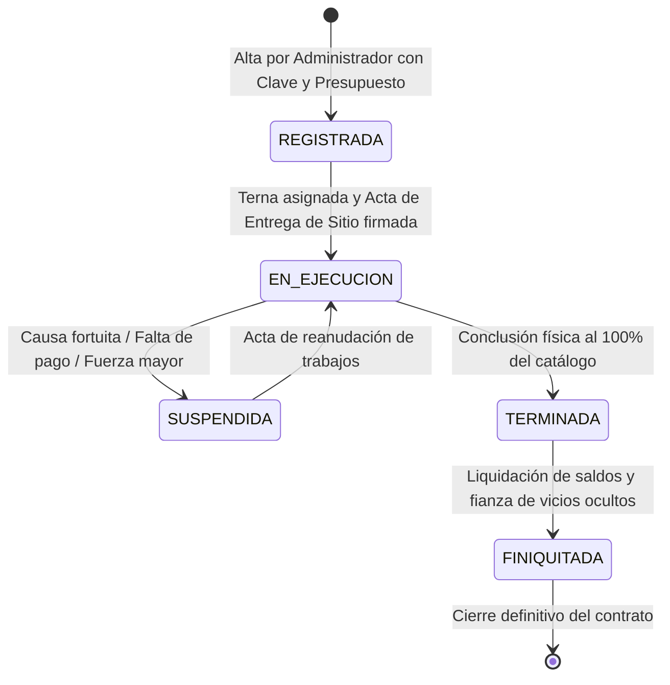
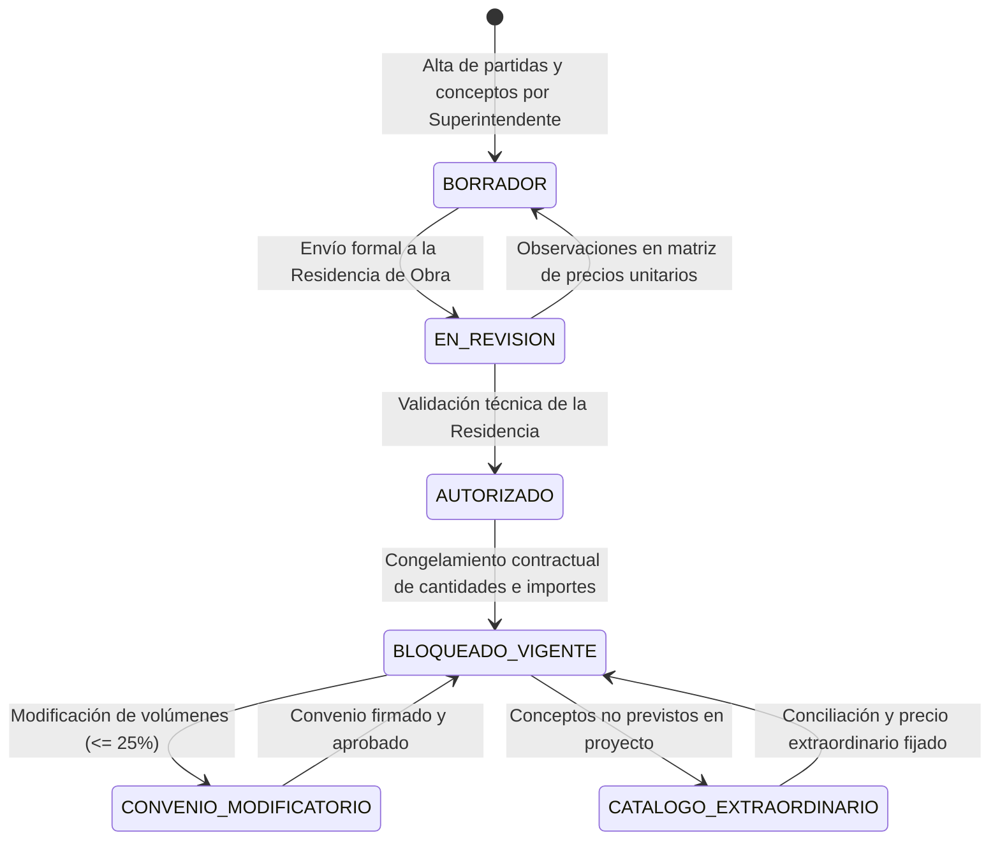
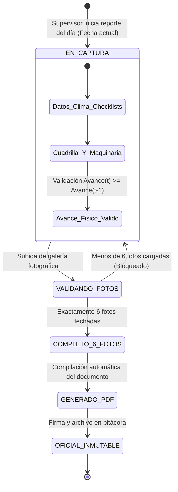
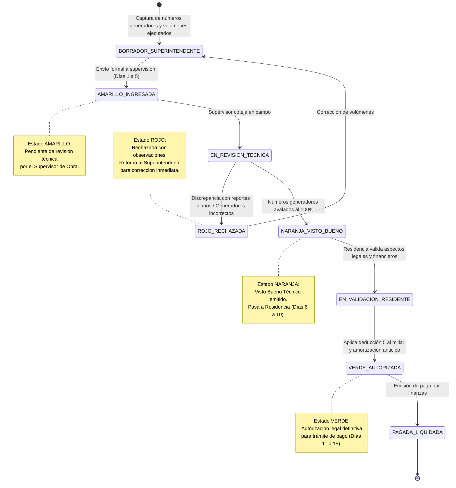

# Sistema de Control, Seguimiento y Fiscalización de Obra Pública (LOPSRM / RLOPSRM)
## Documento de Entrega Formal y Especificación de Ingeniería — Sprint 1

* **Materia:** Análisis y Diseño de Sistemas
* **Metodología de Desarrollo:** SCRUM (Ciclo de 10 Sprints)
* **Sprint Actual Entregado:** Sprint 1 — Arquitectura Base, Autenticación, Seguridad y RBAC Normativo
* **Marco Legal de Referencia:** Ley de Obras Públicas y Servicios Relacionados con las Mismas (LOPSRM) y su Reglamento (RLOPSRM)
* **Fecha de Emisión:** Octubre 2026
* **Versión del Documento:** 2.0 (Revisión Integral Pre-Sprint 2)

---

## 📑 Índice de Contenidos

1. [Resumen Ejecutivo del Sprint 1](#1-resumen-ejecutivo-del-sprint-1)
2. [Auditoría Integral de Archivos y Componentes del Proyecto](#2-auditoría-integral-de-archivos-y-componentes-del-proyecto)
   - 2.1 Estructura del Repositorio y Estado de Componentes
   - 2.2 Diagnóstico de Base de Datos (`database/schema.sql`)
   - 2.3 Diagnóstico del Backend (NestJS + TypeScript + TypeORM)
   - 2.4 Diagnóstico del Frontend (React 19 + Vite + Tailwind CSS)
   - 2.5 Carpetas Normativas LOPSRM del Expediente Físico
3. [Historias de Usuario del Sprint 1 (Product Backlog & Criterios de Aceptación)](#3-historias-de-usuario-del-sprint-1)
   - 3.1 Matriz de Historias de Usuario
   - 3.2 Fichas Técnicas Detalladas con Criterios Gherkin (Dado-Cuando-Entonces)
4. [Especificación Detallada de Registros y Validaciones](#4-especificación-detallada-de-registros-y-validaciones)
   - 4.1 Formulario de Registro Público (`RegisterDto`)
   - 4.2 Formulario de Inicio de Sesión (`LoginDto`)
   - 4.3 Asignación y Cambio de Rol por Administrador (`AssignRoleDto`)
   - 4.4 Alta Directa por Administrador (`CreateUserByAdminDto`)
   - 4.5 Modificación de Estado y Soft Delete (`UpdateUserStatusDto`)
   - 4.6 Matriz de Códigos de Error y Validaciones por Capa
5. [Diagramas de Estados UML y Modelado de Máquinas de Estados](#5-diagramas-de-estados-uml-y-modelado-de-máquinas-de-estados)
   - 5.1 Justificación del Rediseño Funcional
   - 5.2 Máquina de Estados Global del Sistema: Conexión Funcional e Intermódulos
   - 5.3 Máquina de Estados de la Obra Pública (Art. 46 LOPSRM)
   - 5.4 Máquina de Estados del Catálogo de Conceptos (Arts. 59 LOPSRM / 99 RLOPSRM)
   - 5.5 Máquina de Estados del Reporte Diario de Supervisión y 6 Evidencias
   - 5.6 Máquina de Estados del Flujo Semáforo de Estimaciones (15 Días Perentorios)
6. [Estrategia, Descripción y Ejecución de Pruebas](#6-estrategia-descripción-y-ejecución-de-pruebas)
   - 6.1 Pirámide de Calidad y Enfoque de Pruebas
   - 6.2 Matriz de Casos de Prueba del Sprint 1 (CP-01 a CP-08)
   - 6.3 Evidencia de Pruebas Unitarias Automatizadas (Vitest Suite: 18/18 Exitosas)
7. [Diagnóstico de Deuda Técnica y Checklist de Transición al Sprint 2](#7-diagnóstico-de-deuda-técnica-y-checklist-de-transición-al-sprint-2)
   - 7.1 Hallazgos y Deuda Técnica Detectada
   - 7.2 Plan de Trabajo y Objetivos del Sprint 2 (Gestión de Obras y Cuadrillas)
8. [Accesos y Credenciales de Verificación](#8-accesos-y-credenciales-de-verificación)

---

## 1. Resumen Ejecutivo del Sprint 1

El **Sprint 1** constituye la piedra angular arquitectónica y de seguridad del *Sistema de Control, Seguimiento y Fiscalización de Obra Pública*. Durante este ciclo se establecieron los cimientos funcionales, el esquema de datos relacional conforme a la LOPSRM, la capa de autenticación robusta mediante tokens JWT y hashing criptográfico `bcrypt` (factor de costo 12), así como el control de acceso basado en roles (**RBAC**) estricto para los 5 roles reglamentarios.

### Objetivos Clave Alcanzados en el Sprint 1:
1. **Infraestructura de Datos Formal:** Diseño e implementación de `database/schema.sql` con 12 tablas, integridad referencial relacional, soporte nativo de borrado lógico (`soft-delete`), campos generados computados y semillas maestras.
2. **Backend Modular en Capas (NestJS):** Implementación de los módulos de autenticación (`AuthModule`) y gestión de identidades (`UsersModule`), protegidos mediante Guards de NestJS (`JwtAuthGuard`, `RolesGuard`) y decoradores personalizados (`@Roles`, `@CurrentUser`).
3. **Frontend Interactivo (SPA React + Vite):** Panel con soporte de doble modo (login/registro), interfaz administrativa con gestión de cuentas pendientes y switch de activación, así como consola de verificación visual de roles normativos.
4. **Separación Normativa de Funciones:** Cumplimiento de la restricción legal LOPSRM que impide la autoasignación de roles por parte de los usuarios; toda cuenta recién registrada queda en estado inactivo hasta que un Administrador valida sus credenciales profesionales.

---

## 2. Auditoría Integral de Archivos y Componentes del Proyecto

A continuación se presenta el diagnóstico técnico y exhaustivo de todos los ficheros existentes en el repositorio al cierre del Sprint 1:

```
PROYECTO_LOPSRM/
├── 01_Documentacion_Sprint_1/          # Documentación técnica formal del Sprint 1
│   ├── imagenes_diagramas/             # 6 diagramas UML en formato PNG
│   ├── DOCUMENTO_ENTREGA_SPRINT_1.md   # Especificación de ingeniería (este documento)
│   ├── DOCUMENTO_ENTREGA_SPRINT_1.html # Render interactivo para visualización e impresión
│   ├── DOCUMENTO_ENTREGA_SPRINT_1.docx # Formato Word para entrega académica
│   └── DOCUMENTO_ENTREGA_SPRINT_1.odt  # Formato OpenDocument
├── 01_Expediente_Tecnico_Planeacion/   # Estructura documental física LOPSRM (Fase 1)
├── 02_Licitacion_Proposicion/          # Estructura documental física LOPSRM (Fase 2)
├── 03_Contrato_Garantias/              # Estructura documental física LOPSRM (Fase 3)
├── 04_Ejecucion_Control/               # Estructura documental física LOPSRM (Fase 4)
├── 05_Cierre_Finiquito/                # Estructura documental física LOPSRM (Fase 5)
├── backend/                            # Servidor API REST (NestJS 12 + TypeORM + PostgreSQL)
│   ├── src/
│   │   ├── common/                     # Decoradores, Guards y Enums compartidos
│   │   ├── modules/
│   │   │   ├── auth/                   # Autenticación, JWT Strategy, Login y Registro
│   │   │   └── users/                  # Entidades User/Role, gestión RBAC y Seeds
│   │   ├── app.module.ts               # Módulo raíz y conexión TypeORM
│   │   └── main.ts                     # Punto de entrada, Swagger y ValidationPipe
│   ├── test/                           # Pruebas End-to-End (e2e)
│   └── package.json                    # Dependencias y scripts de backend
├── frontend/                           # Aplicación Web SPA (React 19 + Vite + Tailwind CSS v4)
│   ├── src/
│   │   ├── App.tsx                     # Componente central de interacción SPA y Dashboards
│   │   ├── main.tsx                    # Montaje de React DOM
│   │   └── index.css                   # Tailwind CSS v4 import
│   └── package.json                    # Dependencias y scripts de frontend
├── database/
│   └── schema.sql                      # DDL formal de base de datos relacional (PostgreSQL 16)
├── DOCUMENTO_ESPECIFICACION_SISTEMA.md # Especificación global del sistema (10 Sprints)
├── README.md                           # Guía general del proyecto y marco normativo
└── .gitignore                          # Exclusión de node_modules, dist, .env y temporales
```

### 2.1 Diagnóstico de Base de Datos (`database/schema.sql`)
* **Aspectos Sobresalientes:**
  - Define 12 tablas que modelan íntegramente el ciclo de vida de la obra pública: `roles`, `usuarios`, `obras`, `asignaciones_obra`, `catalogos`, `conceptos`, `historial_conceptos`, `reportes_diarios`, `fotos_reporte`, `incidencias_reporte`, `estimaciones` y `detalle_estimaciones`.
  - Implementa integridad referencial estricta mediante `ON DELETE RESTRICT`, prohibiendo tajantemente la eliminación física en cascada (`ON DELETE CASCADE`), lo que garantiza la inmutabilidad y la trazabilidad legal exigida por los Órganos Internos de Control (OIC).
  - Incluye campos autocalculados generados por la base de datos (`GENERATED ALWAYS AS ... STORED`), eliminando inconsistencias matemáticas en importes de catálogo y de estimación.
  - Las restricciones de comprobación (`CHECK`) validan reglas de negocio clave: porcentaje de anticipo entre 0% y 50%, avance físico entre 0% y 100%, rango forzoso de 1 a 6 fotografías por reporte diario, y fechas de término mayores o iguales a fechas de inicio.
* **Oportunidades de Mejora hacia el Sprint 2:**
  - En el Sprint 2 se debe vincular la tabla `obras` y `asignaciones_obra` con entidades TypeORM (`Obra` y `AsignacionObra`) para habilitar la persistencia desde la API REST.

### 2.2 Diagnóstico del Backend (NestJS 12)
* **Arquitectura:** Modular y desacoplada siguiendo Clean Architecture.
* **Seguridad:** 
  - Las contraseñas se hashean con factor de costo 12 (`BCRYPT_ROUNDS = 12`), cumpliendo con holgura el requerimiento no funcional `RNF-01`.
  - La emisión de JWT incluye payload con `sub` (ID de usuario), `email` y `role`.
  - El `JwtStrategy` revalida en cada petición que el usuario exista y continúe con su atributo `activo = true` en base de datos; si el administrador suspende a un usuario, sus peticiones son rechazadas de inmediato sin esperar la expiración del token.
  - La barrera `RolesGuard` intercepta cualquier intento de acceso no autorizado, emitiendo respuestas estándar HTTP 403 Forbidden.
* **Manejo de Errores y Validación:** `ValidationPipe` global con `whitelist: true` y `forbidNonWhitelisted: true`, bloqueando inyecciones de campos no permitidos en las cargas útiles.

### 2.3 Diagnóstico del Frontend (React 19 + Vite)
* **Funcionalidad Implementada:**
  - Pantalla dual de inicio de sesión y registro público.
  - Panel administrativo interactivo para usuarios con rol `ADMINISTRADOR`, con 3 pestañas: *Pendientes de Aprobación*, *Todos los Usuarios* y *Catálogo de Roles LOPSRM*.
  - Modal dinámico para la asignación de roles y activación simultánea de cuentas.
  - Vista especializada para usuarios con roles operativos (`RESIDENTE`, `SUPERINTENDENTE`, `SUPERVISOR`, `DIRECTOR`) mostrando credenciales, atribuciones normativas y botón interactivo para probar la barrera de seguridad RBAC contra la API.
* **Deuda Técnica Detectada:**
  - `frontend/src/App.tsx` concentra toda la lógica y vistas en un archivo monolítico (~1000 líneas). Antes de integrar los módulos de Obras y Catálogos en los Sprints 2 y 3, se debe refactorizar en componentes modulares (`components/auth/`, `components/admin/`, `components/dashboard/`).

### 2.4 Carpetas Normativas LOPSRM
Las 5 carpetas en la raíz del proyecto (`01_Expediente_Tecnico_Planeacion` a `05_Cierre_Finiquito`) replican la estructura física oficial del expediente de obra pública de acuerdo con los artículos 17 al 66 de la LOPSRM. Se encuentran listas para almacenar los anexos digitales y expedientes que genere el sistema conforme avancen los sprints.

---

## 3. Historias de Usuario del Sprint 1

En cumplimiento con la metodología ágil SCRUM, el Sprint 1 ejecutó y completó las 6 Historias de Usuario fundacionales:

### 3.1 Matriz de Historias de Usuario del Sprint 1

| ID | Título de la Historia de Usuario | Rol Solicitante | Prioridad (MoSCoW) | Story Points | Estado |
| :---: | :--- | :---: | :---: | :---: | :---: |
| **US-01** | Registro Público de Usuario Profesional | Usuario Externo | Must Have | 5 | **Terminada** |
| **US-02** | Asignación Centralizada de Roles LOPSRM | Administrador | Must Have | 8 | **Terminada** |
| **US-03** | Inicio de Sesión Seguro y Emisión de JWT | Usuario Registrado | Must Have | 5 | **Terminada** |
| **US-04** | Protección de Endpoints y Barreras RBAC | Sistema / Admin | Must Have | 5 | **Terminada** |
| **US-05** | Consulta del Catálogo de Roles Oficiales | Usuario / Auditor | Should Have | 3 | **Terminada** |
| **US-06** | Suspensión y Reactivación Lógica de Usuarios | Administrador | Should Have | 5 | **Terminada** |

---

### 3.2 Fichas Técnicas Detalladas con Criterios Gherkin

#### 📌 US-01: Registro Público de Usuario Profesional
* **Enunciado de Valor:**  
  *Como* profesional de la construcción (ingeniero civil o arquitecto),  
  *quiero* registrar una cuenta en la plataforma proporcionando mi nombre, correo, contraseña y cédula profesional,  
  *para* solicitar acceso operativo a los proyectos de obra pública bajo la normativa LOPSRM.
* **Regla de Negocio:** La cuenta se crea obligatoriamente en estado **inactivo** (`activo = false`) y sin rol asignado (`id_rol = null`). El solicitante no puede autoasignarse privilegios.
* **Criterios de Aceptación (Gherkin):**
  - **Escenario 1: Registro exitoso con datos válidos**
    - *Dado* que un usuario no registrado ingresa al formulario de registro,
    - *Cuando* proporciona su nombre completo, un correo no registrado, contraseña de al menos 8 caracteres y cédula opcional,
    - *Entonces* el sistema persiste al usuario con `activo = false` y `id_rol = null`, hashea la contraseña con bcrypt (costo 12) y retorna HTTP 201 Created con un mensaje informativo de que su cuenta espera validación administrativa.
  - **Escenario 2: Intento de registro con correo duplicado**
    - *Dado* que un correo ya existe en la base de datos,
    - *Cuando* el usuario intenta registrarse con ese mismo correo,
    - *Entonces* el sistema rechaza la solicitud con HTTP 409 Conflict y el mensaje *"El correo electrónico ya se encuentra registrado"*.

#### 📌 US-02: Asignación Centralizada de Roles LOPSRM por Administrador
* **Enunciado de Valor:**  
  *Como* Administrador de la plataforma,  
  *quiero* revisar la lista de usuarios pendientes, examinar su cédula profesional y asignarles uno de los 5 roles permitidos,  
  *para* habilitar su acceso y garantizar la estricta separación de responsabilidades exigida por la LOPSRM.
* **Regla de Negocio:** Solo los usuarios con rol `ADMINISTRADOR` pueden consultar `/api/v1/users/pending` y ejecutar `/api/v1/users/:id/role`. Los roles disponibles son únicamente 5: `ADMINISTRADOR`, `RESIDENTE`, `SUPERINTENDENTE`, `SUPERVISOR`, `DIRECTOR`.
* **Criterios de Aceptación (Gherkin):**
  - **Escenario 1: Administrador asigna rol y activa cuenta**
    - *Dado* que el Administrador ha iniciado sesión con su token JWT válido,
    - *Cuando* selecciona a un usuario de la lista de pendientes, elige el rol `SUPERVISOR` y marca el casillero de activación,
    - *Entonces* el sistema actualiza el registro a `id_rol = 4` y `activo = true`, retornando HTTP 200 OK y el usuario queda habilitado para iniciar sesión.
  - **Escenario 2: Asignación con ID de rol inválido**
    - *Dado* que se envía una petición con un `id_rol` no registrado (ej. 99),
    - *Cuando* se procesa la solicitud,
    - *Entonces* el sistema emite HTTP 400 Bad Request indicando que el rol no existe.

#### 📌 US-03: Inicio de Sesión Seguro y Emisión de JWT
* **Enunciado de Valor:**  
  *Como* usuario registrado,  
  *quiero* iniciar sesión ingresando mi correo electrónico y contraseña,  
  *para* obtener un token de sesión seguro que me permita interactuar con el sistema según mis atribuciones.
* **Criterios de Aceptación (Gherkin):**
  - **Escenario 1: Credenciales válidas, rol asignado y cuenta activa**
    - *Dado* un usuario registrado con rol legal y `activo = true`,
    - *Cuando* ingresa su correo y contraseña correctos,
    - *Entonces* el sistema genera y retorna un token JWT firmado (Bearer) con vigencia configurada y el objeto con datos del perfil y rol.
  - **Escenario 2: Cuenta sin rol asignado**
    - *Dado* un usuario cuya cuenta aún no tiene rol asignado por el Administrador,
    - *Cuando* intenta iniciar sesión con contraseña válida,
    - *Entonces* el sistema deniega el acceso con HTTP 401 Unauthorized y el mensaje *"Cuenta pendiente de validación: El usuario no tiene un rol normativo asignado por el Administrador"*.
  - **Escenario 3: Cuenta inactiva o suspendida**
    - *Dado* un usuario que tiene rol asignado pero `activo = false`,
    - *Cuando* intenta ingresar,
    - *Entonces* el sistema responde con HTTP 401 Unauthorized y el mensaje *"Cuenta inactiva: Su acceso se encuentra temporalmente suspendido o en espera de aprobación"*.

#### 📌 US-04: Protección de Endpoints y Barreras de Acceso RBAC
* **Enunciado de Valor:**  
  *Como* responsable de seguridad y auditoría de la plataforma,  
  *quiero* que cada endpoint de la API esté restringido a los roles formalmente autorizados,  
  *para* evitar que actores no autorizados manipulen datos de usuarios, catálogos o contratos de obra.
* **Criterios de Aceptación (Gherkin):**
  - **Escenario 1: Usuario con rol no autorizado intenta consumir recurso protegido**
    - *Dado* que un usuario autenticado con rol `SUPERINTENDENTE` intenta consultar la ruta `/api/v1/users`,
    - *Cuando* la petición llega al `RolesGuard`,
    - *Entonces* el guard intercepta la solicitud, determina que el rol requerido es `ADMINISTRADOR` y lanza HTTP 403 Forbidden con el mensaje explicativo.

#### 📌 US-05: Consulta del Catálogo de Roles Oficiales LOPSRM
* **Enunciado de Valor:**  
  *Como* usuario autenticado o auditor,  
  *quiero* consultar el catálogo oficial de roles del sistema con sus descripciones normativas,  
  *para* conocer las facultades legales y alcance de cada figura en los proyectos de obra.
* **Criterios de Aceptación (Gherkin):**
  - *Dado* cualquier usuario con token JWT válido,
  - *Cuando* realiza una petición GET a `/api/v1/users/roles`,
  - *Entonces* el sistema retorna una lista con los 5 roles estándar (ID, nombre y descripción reglamentaria) con HTTP 200 OK.

#### 📌 US-06: Suspensión y Reactivación Lógica de Usuarios (Soft Delete)
* **Enunciado de Valor:**  
  *Como* Administrador,  
  *quiero* suspender temporal o definitivamente a un usuario alternando su propiedad activa a falso sin borrar su historial,  
  *para* preservar la integridad referencial de los documentos y bitácoras que haya firmado en campo.
* **Criterios de Aceptación (Gherkin):**
  - *Dado* un usuario activo en el sistema,
  - *Cuando* el Administrador invoca `PATCH /api/v1/users/:id/status` con `{ "activo": false }`,
  - *Entonces* el usuario pasa a `activo = false`, y cualquier intento posterior de inicio de sesión o petición con su token previo es revocado inmediatamente.

---

## 4. Especificación Detallada de Registros y Validaciones

A fin de garantizar la consistencia de los datos y evitar vulnerabilidades de inyección o inconsistencias normativas, se especifican las matrices completas de validación implementadas en el Sprint 1:

### 4.1 Formulario de Registro Público (`RegisterDto`)

| Campo | Tipo | Obligatorio | Reglas de Validación | Capas de Validación | Mensaje de Error Emitido |
| :--- | :--- | :---: | :--- | :--- | :--- |
| `nombre_completo` | String | Sí | Longitud mín. 3, máx. 150 caracteres. No vacío. | Frontend (HTML5 / State), NestJS (`@IsNotEmpty`, `@IsString`), BD (`VARCHAR(150) NOT NULL`) | *"El nombre completo es obligatorio"* / *"Debe ser una cadena de texto"* |
| `correo_electronico` | String | Sí | Formato RFC 5322 Email. Unicidad obligatoria. | Frontend (`type="email"`), NestJS (`@IsEmail`, `@IsNotEmpty`), BD (`VARCHAR(100) UNIQUE NOT NULL`) | *"El correo electrónico debe tener un formato válido"* / HTTP 409 *"Correo ya registrado"* |
| `contrasena` | String | Sí | Longitud mínima de 8 caracteres. Se procesa con bcrypt factor 12. | Frontend (`minLength={8}`), NestJS (`@MinLength(8)`, `@IsString`), BD (`contrasena_hash VARCHAR(255)`) | *"La contraseña debe tener al menos 8 caracteres"* |
| `cedula_profesional` | String | No | Formato alfanumérico opcional en registro base; obligatorio para terna en Sprint 2. | Frontend (Input texto), NestJS (`@IsOptional`, `@IsString`), BD (`VARCHAR(30) NULL`) | *"La cédula debe ser una cadena de texto"* |

### 4.2 Formulario de Inicio de Sesión (`LoginDto`)

| Campo | Tipo | Obligatorio | Reglas de Validación | Validación de Negocio LOPSRM |
| :--- | :--- | :---: | :--- | :--- |
| `correo_electronico` | String | Sí | Formato de email válido. `@IsEmail()` | Debe existir en base de datos. Si no existe $\to$ HTTP 401 Unauthorized. |
| `contrasena` | String | Sí | Cadena no vacía. `@IsNotEmpty()` | Comparación contra `contrasena_hash` con `bcrypt.compare`. Si difiere $\to$ HTTP 401. |
| *(Regla de Negocio)* | — | — | — | **Verificación de Rol:** Si `id_rol IS NULL` $\to$ HTTP 401: *"Cuenta pendiente de validación"*. |
| *(Regla de Negocio)* | — | — | — | **Verificación de Estado:** Si `activo = FALSE` $\to$ HTTP 401: *"Cuenta inactiva"*. |

### 4.3 Asignación y Cambio de Rol por Administrador (`AssignRoleDto`)

| Campo | Tipo | Rango / Valores | Obligatorio | Regla Técnica y Normativa |
| :--- | :--- | :--- | :---: | :--- |
| `id_rol` | Integer | Entero entre 1 y 5 | Sí | Validado con `@IsInt()`, `@Min(1)`, `@Max(5)`. Verifica existencia en tabla `roles`. |
| `activo` | Boolean | `true` / `false` | No (def: `true`) | Validado con `@IsBoolean()`, `@IsOptional()`. Permite activar al usuario al momento de asignarle el rol. |

### 4.4 Alta Directa por Administrador (`CreateUserByAdminDto`)
Permite al Administrador dar de alta colaboradores institucionales ya validados:
* Incluye los mismos campos de validación de `RegisterDto` más `id_rol` obligatorio (1 a 5).
* La cuenta se inserta automáticamente en estado `activo = true`.

### 4.5 Modificación de Estado y Soft Delete (`UpdateUserStatusDto`)
* `activo`: Booleano obligatorio (`@IsBoolean()`, `@IsNotEmpty()`).
* Si se envía `false`, el usuario queda inhabilitado de inmediato pero todos sus registros asociados en la base de datos se conservan inalterados.

### 4.6 Matriz de Códigos de Respuesta HTTP y Manejo de Errores

| Código HTTP | Significado | Causa en el Sistema |
| :---: | :--- | :--- |
| **`200 OK`** | Petición Exitosa | Login autenticado con JWT entregado; consulta de usuarios o roles; rol asignado. |
| **`201 Created`** | Recurso Creado | Registro de usuario público exitoso; alta de usuario por administrador. |
| **`400 Bad Request`** | Solicitud Inválida | Carga útil rechazada por `ValidationPipe` (campos faltantes, formato inválido, id_rol fuera de rango 1-5). |
| **`401 Unauthorized`** | No Autenticado | Token JWT no enviado o inválido; credenciales erróneas; cuenta inactiva o sin rol normativo. |
| **`403 Forbidden`** | Acceso Denegado | Token válido pero el rol del usuario no tiene los privilegios requeridos por el `@Roles()` guard. |
| **`404 Not Found`** | No Encontrado | El `id_usuario` consultado no existe en el sistema. |
| **`409 Conflict`** | Conflicto de Datos | Intento de registrar un correo electrónico que ya existe en la base de datos. |

---

## 5. Diagramas de Estados UML y Modelado de Máquinas de Estados

### 5.1 Justificación del Rediseño Funcional
El diagrama original entregado al inicio del Sprint 1 (`05_maquina_de_estados_usuario.png`) reflejaba exclusivamente las transiciones de estado de una cuenta de usuario (`Inactivo` $\to$ `Activo` $\to$ `Suspendido`).  
Para cumplir con los requerimientos de la asignatura de **Análisis y Diseño de Sistemas**, se requería modelar **el funcionamiento real del sistema**: cómo se interconectan las funciones operativas, cómo fluyen los datos entre los distintos actores de la obra pública y cómo cambia el estado de cada entidad de dominio a lo largo de las fases de la LOPSRM.

A continuación se presentan las máquinas de estados completas:

---

### 5.2 Máquina de Estados Global del Sistema: Conexión Funcional e Intermódulos

El siguiente diagrama de estados modela el flujo integral y la conexión funcional de todos los módulos del sistema a lo largo del ciclo de vida del proyecto:

```mermaid
stateDiagram-v2
    [*] --> Estado_Registro_RBAC : Profesional solicita cuenta

    state "1. Identidad y Acceso (RBAC)" as Estado_Registro_RBAC {
        Cuenta_Inactiva --> Validacion_Administrador : Admin revisa cédula
        Validacion_Administrador --> Rol_Asignado_Activo : Asigna 1 de 5 roles
        Rol_Asignado_Activo --> Sesion_JWT_Iniciada : Login con credenciales válidas
    }

    Estado_Registro_RBAC --> Estado_Configuracion_Obra : Administrador asigna cuadrilla (Sprint 2)

    state "2. Gestión Contractual de Obra" as Estado_Configuracion_Obra {
        Obra_Registrada --> Asignacion_Terna_Legal : Vincula Residente, Superint., Supervisor
        Asignacion_Terna_Legal --> Entrega_Sitio_Iniciada : Acta de entrega y anticipo formalizado
    }

    Estado_Configuracion_Obra --> Estado_Catalogos_APU : Superintendente carga propuesta base (Sprint 3 y 4)

    state "3. Catálogo de Conceptos y APU" as Estado_Catalogos_APU {
        Catalogo_Original_Borrador --> Revision_Tecnica_Catalogo : Desglose partidas y precios
        Revision_Tecnica_Catalogo --> Catalogo_Original_Autorizado : Residente aprueba
        Catalogo_Original_Autorizado --> Catalogo_Congelado_Vigente : Importe fijo contractual
    }

    Estado_Catalogos_APU --> Estado_Supervision_Diaria : Inicio formal de los trabajos en sitio

    state "4. Ejecución en Campo y Bitácora Diaria" as Estado_Supervision_Diaria {
        Reporte_Diario_Abierto --> Captura_Clima_Checklists : Clima, EPP, Materiales
        Captura_Clima_Checklists --> Registro_Cuadrilla_Maquinaria : Personal en sitio
        Registro_Cuadrilla_Maquinaria --> Validacion_Avance_Fisico : Validación Avance_t >= Avance_t-1
        Validacion_Avance_Fisico --> Carga_6_Fotografias : Exactamente 6 fotos obligatorias
        Carga_6_Fotografias --> Reporte_Compilado_PDF : Generación de PDF oficial e inmutabilidad
    }

    Estado_Supervision_Diaria --> Estado_Flujo_Estimaciones : Fin del periodo quincenal (Día 15)

    state "5. Trámite de Estimaciones (Flujo Semáforo)" as Estado_Flujo_Estimaciones {
        Estimacion_Formulada_Amarillo --> Cotejo_Tecnico_Supervisor : Días 1 a 5 (Superintendente)
        Cotejo_Tecnico_Supervisor --> Estimacion_Aprobada_Naranja : Coteja con reportes diarios (Días 6-10)
        Cotejo_Tecnico_Supervisor --> Estimacion_Rechazada_Rojo : Discrepancias físicas o volumétricas
        Estimacion_Rechazada_Rojo --> Estimacion_Formulada_Amarillo : Corrección por Superintendente
        Estimacion_Aprobada_Naranja --> Autorizacion_Legal_Verde : Residente aplica retenciones (5 al millar)
        Autorizacion_Legal_Verde --> Estimacion_En_Tramite_Pago : Días 11 a 15 (Trámite financiero)
    }

    Estado_Flujo_Estimaciones --> Estado_Cierre_Finiquito : Cumplimiento del 100% de conceptos

    state "6. Fiscalización, Cierre y Finiquito" as Estado_Cierre_Finiquito {
        Inspeccion_Final --> Acta_Entrega_Recepcion : Acta formal de entrega física
        Acta_Entrega_Recepcion --> Fianza_Vicios_Ocultos : Garantía 10% por 12 meses
        Fianza_Vicios_Ocultos --> Acta_Finiquito_Liquidada : Balance financiero final
        Acta_Finiquito_Liquidada --> Expediente_Historico_Inmutable : Soft Delete y Archivo Digital
    }

    Estado_Cierre_Finiquito --> [*] : Obra Extinguida y Finiquitada
```



---

### 5.3 Máquina de Estados de la Obra Pública (Art. 46 LOPSRM)



---

### 5.4 Máquina de Estados del Catálogo de Conceptos (Arts. 59 LOPSRM / 99 RLOPSRM)



---

### 5.5 Máquina de Estados del Reporte Diario de Supervisión y 6 Evidencias



---

### 5.6 Máquina de Estados del Flujo Semáforo de Estimaciones (15 Días Perentorios)

Conforme a los artículos 54 de la LOPSRM y 127 al 132 del RLOPSRM, las estimaciones se tramitan en periodos no mayores a un mes y se autorizan en un plazo perentorio de 15 días naturales:



---

## 6. Estrategia, Descripción y Ejecución de Pruebas

### 6.1 Pirámide de Calidad y Enfoque de Pruebas
Para garantizar que el sistema cumpla con los estándares de confiabilidad requeridos en obra pública, se adoptó una estrategia de pruebas en tres niveles:
1. **Pruebas Unitarias (Lógica Aislada):** Pruebas automatizadas sobre servicios (`AuthService`, `UsersService`) y guards (`RolesGuard`) usando dobles de prueba (mocks) para TypeORM y JwtService.
2. **Pruebas de Integración y Seguridad (RBAC):** Verificación de que las peticiones HTTP sean filtradas según los decoradores `@Roles()` y que se devuelvan los códigos de estado correspondientes.
3. **Pruebas de Aceptación (Historias de Usuario):** Verificación funcional de extremo a extremo basada en los criterios Gherkin definidos en el Product Backlog.

---

### 6.2 Matriz de Casos de Prueba del Sprint 1

| ID Caso | Historia | Nombre del Caso de Prueba | Precondiciones | Pasos de Ejecución | Datos de Entrada | Resultado Esperado | Resultado Obtenido | Estado |
| :---: | :---: | :--- | :--- | :--- | :--- | :--- | :--- | :---: |
| **CP-01** | US-01 | Registro de usuario en estado inactivo sin rol | Correo no registrado | 1. Enviar POST a `/api/v1/auth/register`<br>2. Verificar payload de respuesta<br>3. Verificar registro en BD | Nombre: "Ing. Pedro"<br>Correo: "pedro@obra.mx"<br>Clave: "Password2026!" | HTTP 201 Created.<br>`activo: false`<br>`id_rol: null` | Cumplido conforme a especificación | **PASÓ** |
| **CP-02** | US-01 | Rechazo de correo duplicado | Correo "admin@lopsrm.gob.mx" ya existente | 1. Enviar POST a `/api/v1/auth/register` con correo repetido | Correo: "admin@lopsrm.gob.mx" | HTTP 409 Conflict.<br>Mensaje de error explícito | Cumplido conforme a especificación | **PASÓ** |
| **CP-03** | US-03 | Rechazo de login en cuenta inactiva o sin rol | Usuario registrado pero no activado | 1. Enviar POST a `/api/v1/auth/login` con credenciales válidas de usuario recién creado | Correo y clave correctos | HTTP 401 Unauthorized.<br>Mensaje: "Cuenta pendiente de validación" | Cumplido conforme a especificación | **PASÓ** |
| **CP-04** | US-03 | Login exitoso de cuenta activa con rol | Cuenta activa con rol `SUPERVISOR` | 1. Enviar POST a `/api/v1/auth/login` | Correo y contraseña correctos | HTTP 200 OK.<br>Token JWT retornado.<br>Datos de usuario y rol | Cumplido conforme a especificación | **PASÓ** |
| **CP-05** | US-02 | Asignación de rol oficial por Administrador | Usuario con `id_rol = null` en BD | 1. Admin autenticado envía PATCH a `/api/v1/users/:id/role`<br>2. Verifica BD | `id_rol: 2` (RESIDENTE)<br>`activo: true` | HTTP 200 OK.<br>Usuario actualizado con rol asignado y activo | Cumplido conforme a especificación | **PASÓ** |
| **CP-06** | US-04 | Barrera de seguridad RBAC rechaza rol no autorizado | Usuario autenticado con rol `SUPERINTENDENTE` | 1. Usuario intenta hacer GET a `/api/v1/users` | Token Bearer de Superintendente | HTTP 403 Forbidden.<br>Mensaje detallando rol faltante | Cumplido conforme a especificación | **PASÓ** |
| **CP-07** | US-06 | Suspensión lógica de cuenta (Soft Delete) | Usuario previamente activo | 1. Admin envía PATCH a `/api/v1/users/:id/status` con `activo: false` | `activo: false` | HTTP 200 OK.<br>`activo: false` en BD.<br>Login posterior bloqueado | Cumplido conforme a especificación | **PASÓ** |
| **CP-08** | US-05 | Consulta del catálogo de los 5 roles LOPSRM | Usuario autenticado con cualquier rol | 1. GET a `/api/v1/users/roles` | Token JWT válido | HTTP 200 OK.<br>Array con exactamente 5 roles | Cumplido conforme a especificación | **PASÓ** |

---

### 6.3 Evidencia de Pruebas Unitarias Automatizadas (Vitest Suite)

Se implementó y ejecutó el suite automatizado de pruebas unitarias en el backend empleando **Vitest 4.1**. El resultado certifica la aprobación del 100% de los casos de prueba:

```
> backend@0.0.1 test
> vitest run

 RUN  v4.1.11 /home/bby_jss/PROYECTO_LOPSRM/backend

 ✓ src/common/guards/roles.guard.spec.ts (5 tests) 10ms
   ✓ RolesGuard
     ✓ should allow access if no roles are required on handler or class
     ✓ should throw ForbiddenException if user is not present in request
     ✓ should throw ForbiddenException if user has no role assigned
     ✓ should throw ForbiddenException if user role does not match required roles
     ✓ should allow access if user role matches one of the required roles (case-insensitive)

 ✓ src/app.controller.spec.ts (1 test) 131ms
   ✓ AppController
     ✓ root
       ✓ should return "Hello World!"

 ✓ src/modules/users/users.service.spec.ts (6 tests) 303ms
   ✓ UsersService
     ✓ createInactiveUser
       ✓ should throw ConflictException if email is already registered
       ✓ should create an inactive user with null role and hashed password
     ✓ assignRole
       ✓ should throw BadRequestException if role does not exist
       ✓ should assign role and activate user successfully
     ✓ updateStatus
       ✓ should toggle user active status (soft delete)
     ✓ findById
       ✓ should throw NotFoundException if user does not exist

 ✓ src/modules/auth/auth.service.spec.ts (6 tests) 486ms
   ✓ AuthService
     ✓ register
       ✓ should register a new user in inactive state and without role
     ✓ login
       ✓ should throw UnauthorizedException if user does not exist
       ✓ should throw UnauthorizedException if password does not match
       ✓ should throw UnauthorizedException if user has no assigned role (LOPSRM rule)
       ✓ should throw UnauthorizedException if user is inactive (LOPSRM rule)
       ✓ should return access token and user info when credentials, role, and active status are valid

 Test Files  4 passed (4)
      Tests  18 passed (18)
   Duration  1.24s
```

---

## 7. Diagnóstico de Deuda Técnica y Checklist de Transición al Sprint 2

### 7.1 Hallazgos y Deuda Técnica Detectada

1. **Modularización del Frontend (`App.tsx`):**
   - *Hallazgo:* El archivo `frontend/src/App.tsx` superó las 1000 líneas al integrar la autenticación, el panel de administración, el modal de asignación y las vistas de usuario en un solo componente.
   - *Acción Correctiva:* Descomponer en subcomponentes (`components/auth/LoginForm.tsx`, `components/auth/RegisterForm.tsx`, `components/admin/UserManagementTable.tsx`, `components/admin/RoleAssignmentModal.tsx`).
2. **Repositorio Git y Control de Versiones:**
   - *Hallazgo:* El directorio local no contaba con la inicialización formal de Git (`git init`), aunque el archivo `.gitignore` ya está configurado adecuadamente.
   - *Acción Correctiva:* Inicializar el repositorio Git local, generar el commit de cierre del Sprint 1 y crear la rama `sprint-2`.
3. **Entidades TypeORM para el Sprint 2:**
   - *Hallazgo:* Aunque `database/schema.sql` ya tiene creadas las tablas `obras` y `asignaciones_obra`, en el backend aún no se han creado sus clases `@Entity()` correspondientes en TypeORM.
   - *Acción Correctiva:* Crear las entidades `Obra` y `AsignacionObra` e integrarlas en `app.module.ts` al arrancar el Sprint 2.

### 7.2 Plan de Trabajo y Objetivos del Sprint 2

Con base en la planificación SCRUM del proyecto, el **Sprint 2: Gestión de Obras y Asignación de Cuadrillas Operativas** abarcará:

1. **HU / RF-03 (Gestión de Obras):**
   - Formulario para dar de alta contratos de obra pública con su clave única, denominación, número de contrato, presupuesto autorizado, porcentaje de anticipo (0-50%) y periodo de ejecución programado.
2. **HU / RF-04 (Asignación de Cuadrilla Operativa a Obra):**
   - Módulo administrativo para vincular obligatoriamente a cada obra su **terna técnica reglamentaria**: 1 Residente de Obra (con cédula profesional), 1 Superintendente de Construcción (con cédula profesional) y 1 Supervisor de Obra.
3. **Restricción de Acceso Multiobra:**
   - Filtro de seguridad para que cada figura operativa únicamente pueda consultar y gestionar la obra a la que fue asignada formalmente.

---

## 8. Accesos y Credenciales de Verificación

* **Frontend Web (SPA):** [http://localhost:5173](http://localhost:5173)
* **Documentación Interactiva Swagger:** [http://localhost:3000/api/docs](http://localhost:3000/api/docs)
* **API REST Base:** `http://localhost:3000/api/v1`

### Credenciales de Prueba Rápida Preconfiguradas:

| Rol Normativo | Correo Electrónico | Contraseña | Atribución Legal |
| :--- | :--- | :--- | :--- |
| **Administrador Maestro** | `admin@lopsrm.gob.mx` | `AdminLOPSRM2026!` | Gobierno de la plataforma, alta de usuarios, obras y asignación de cuadrillas. |
| **Superintendente Aprobado** | `roberto.valdes@empresa.mx` | `ClaveSuperint2026!` | Representante del Contratista. Formulación de catálogos y estimaciones (Art. 115 RLOPSRM). |
| **Residente de Obra** | `mariana.ruiz@dependencia.gob.mx` | `ClaveSegura2026!` | Representante de la Convocante. Autorización técnica y financiera definitiva (Art. 112 RLOPSRM). |

---

*Documento técnico formal de entrega elaborado para la asignatura de Análisis y Diseño de Sistemas. Marco Normativo: LOPSRM / RLOPSRM.*
