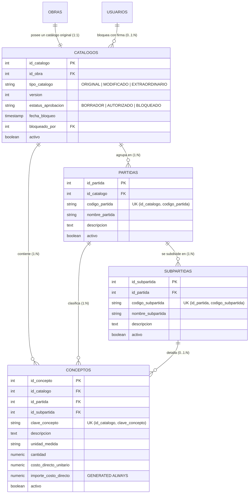
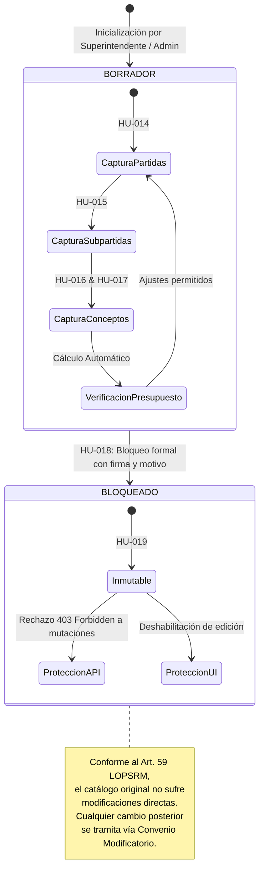

# Sistema de Control, Seguimiento y Fiscalización de Obra Pública (LOPSRM / RLOPSRM)
## Documento de Entrega Formal y Especificación de Ingeniería — Sprint 3

* **Materia:** Análisis y Diseño de Sistemas
* **Metodología de Desarrollo:** SCRUM (Ciclo de 10 Sprints)
* **Sprint Actual Entregado:** Sprint 3 — Catálogo Original de Conceptos, Estructura Jerárquica e Inmutabilidad Normativa
* **Épica Asociada:** Catálogo Original
* **Historias de Usuario Cubiertas:** HU-014, HU-015, HU-016, HU-017, HU-018 y HU-019
* **Marco Legal de Referencia:** Ley de Obras Públicas y Servicios Relacionados con las Mismas (LOPSRM, Arts. 59 y 65) y su Reglamento (RLOPSRM, Arts. 99, 112 y 115)
* **Fecha de Emisión:** Octubre 2026
* **Versión del Documento:** 1.0 (Entrega Formal Sprint 3)

---

## 📑 Índice de Contenidos

1. [Resumen Ejecutivo del Sprint 3](#1-resumen-ejecutivo-del-sprint-3)
2. [Matriz de Requerimientos e Historias de Usuario (Sprint 3)](#2-matriz-de-requerimientos-e-historias-de-usuario-sprint-3)
   - 2.1 Mapeo de Requerimientos y Criterios de Aceptación
   - 2.2 Desglose de Tareas Técnicas por Historia de Usuario
3. [Arquitectura de Datos y Modelo Relacional Jerárquico](#3-arquitectura-de-datos-y-modelo-relacional-jerárquico)
   - 3.1 Diagrama Entidad-Relación (Catálogo, Partidas, Subpartidas y Conceptos)
   - 3.2 Restricciones de Integridad y Unicidad Compuesta
   - 3.3 Cálculo Automático de Importe Directo y Precios Unitarios
4. [Diseño de Máquina de Estados e Inmutabilidad Legal (Arts. 59 LOPSRM / HU-018 & HU-019)](#4-diseño-de-máquina-de-estados-e-inmutabilidad-legal)
   - 4.1 Ciclo de Vida del Catálogo Original
   - 4.2 Barrera de Seguridad Transversal en Backend y Frontend
5. [Fichas Técnicas Detalladas de Historias de Usuario (Gherkin Dado-Cuando-Entonces)](#5-fichas-técnicas-detalladas-de-historias-de-usuario)
   - 5.1 HU-014: Registrar Partidas
   - 5.2 HU-015: Registrar Subpartidas Asociadas a una Partida
   - 5.3 HU-016: Asignar ID Único a Cada Concepto
   - 5.4 HU-017: Capturar Datos Necesarios de Cada Concepto
   - 5.5 HU-018: Bloquear el Catálogo Original después de su Captura
   - 5.6 HU-019: Impedir Modificaciones Directas al Catálogo Original
6. [Implementación de Software (Backend & Frontend)](#6-implementación-de-software-backend--frontend)
   - 6.1 Backend Modular (`CatalogosModule`, NestJS + TypeORM)
   - 6.2 Frontend SPA (`React 19` + `Vite` + `Tailwind CSS`)
   - 6.3 Endpoints REST y Documentación OpenAPI/Swagger
7. [Estrategia y Evidencia de Pruebas Automatizadas](#7-estrategia-y-evidencia-de-pruebas-automatizadas)
   - 7.1 Matriz de Casos de Prueba
   - 7.2 Resultados de Ejecución Vitest (47/47 Pruebas Unitarias Aprobadas)
8. [Conclusión y Transición al Sprint 4](#8-conclusión-y-transición-al-sprint-4)

---

## 1. Resumen Ejecutivo del Sprint 3

El **Sprint 3** implementa la gestión formal del **Catálogo Original de Conceptos de Obra Pública**, elemento contractual fundamental sobre el cual se basan el presupuesto adjudicado, la programación de obra y el cobro futuro de estimaciones.

Conforme al marco legal mexicano (Arts. 59 de la LOPSRM y 99 de su Reglamento), el catálogo de conceptos formalizado en el contrato o licitación debe permanecer inmutable una vez capturado y autorizado. Cualquier modificación física o de precio posterior no altera el catálogo original, sino que genera catálogos Modificados o Extraordinarios mediante Convenio Modificatorio.

### Objetivos Clave Alcanzados en el Sprint 3:
1. **Jerarquización Completa del Catálogo (HU-014 y HU-015):** Creación de partidas y subpartidas relacionales que permiten clasificar los trabajos de construcción de forma ordenada (ej: Preliminares -> Trazo y Nivelación).
2. **Identificación Unívoca y Captura Integral (HU-016 y HU-017):** Asignación y validación estricta de ID/Clave única para cada concepto dentro del catálogo, con captura de unidades, cantidades proyectadas, matrices de precios unitarios y cálculo de importes mediante columnas calculadas.
3. **Bloqueo Normativo e Inmutabilidad (HU-018 y HU-019):** Transición formal de estado `BORRADOR` a `BLOQUEADO` efectuada por el Superintendente de Construcción o Administrador, registrando auditoría pericial (timestamp y usuario responsable). Una vez bloqueado, tanto la API como la interfaz rechazan y bloquean cualquier intento de modificación, adición o borrado directo.

---

## 2. Matriz de Requerimientos e Historias de Usuario (Sprint 3)

### 2.1 Mapeo de Requerimientos y Criterios de Aceptación

| Épica | ID | Nombre de Historia de Usuario | Descripción (Rol / Necesidad / Beneficio) | Criterio de Aceptación Oficial |
| :--- | :--- | :--- | :--- | :--- |
| **Catálogo original** | **HU-014** | Registrar partidas | *Como Superintendente quiero registrar las partidas del catálogo original para estructurar los conceptos de la obra.* | El Superintendente puede registrar una partida válida en el catálogo original. |
| **Catálogo original** | **HU-015** | Registrar subpartidas asociadas a una partida | *Como Superintendente quiero registrar subpartidas dentro de cada partida para organizar detalladamente el catálogo.* | Una subpartida queda asociada a la partida correcta. |
| **Catálogo original** | **HU-016** | Asignar ID único a cada concepto | *Como Superintendente quiero que cada concepto tenga un identificador único para poder localizarlo y relacionarlo con otros procesos.* | Cada concepto posee un identificador único. |
| **Catálogo original** | **HU-017** | Capturar datos necesarios de cada concepto | *Como Superintendente quiero capturar la información de cada concepto para integrar el catálogo original de la obra.* | El formulario permite capturar y almacenar todos los datos requeridos del concepto. |
| **Catálogo original** | **HU-018** | Bloquear el catálogo original después de su captura | *Como Superintendente quiero finalizar y bloquear el catálogo original para evitar modificaciones posteriores a su captura.* | Un catálogo bloqueado no puede ser editado directamente. |
| **Catálogo original** | **HU-019** | Impedir modificaciones directas al catálogo original | *Como Administrador quiero controlar el estado del catálogo original para asegurar que ningún usuario realice modificaciones no autorizadas.* | Los intentos de modificación directa al catálogo original son rechazados. |

### 2.2 Desglose de Tareas Técnicas por Historia de Usuario

* **HU-014 (Registrar partidas):**
  1. Diseñar formulario de captura con validación de código y nombre.
  2. Validar tipos de datos y unicidad del código de partida dentro del catálogo.
  3. Guardar registro en la tabla relacional `partidas`.
  4. Probar registro exitoso y rechazo de códigos duplicados.
* **HU-015 (Registrar subpartidas asociadas a una partida):**
  1. Crear relación de llave foránea `partida-subpartida` en base de datos.
  2. Construir formulario de subpartida subordinado a la selección de partida padre.
  3. Validar unicidad compuesta `(id_partida, codigo_subpartida)`.
  4. Probar consulta y renderizado jerárquico.
* **HU-016 (Asignar ID único a cada concepto):**
  1. Definir formato de clave/ID (alfanumérico estructurado `[PREL-001]`).
  2. Implementar generador automático de clave secuencial según partida.
  3. Validar unicidad estricta en base de datos `(id_catalogo, clave_concepto)`.
  4. Probar rechazo de conceptos con clave duplicada.
* **HU-017 (Capturar datos necesarios de cada concepto):**
  1. Definir campos obligatorios: clave, descripción, unidad de medida, cantidad y costo directo unitario.
  2. Construir formulario reactivo con cálculo dinámico del importe en pantalla.
  3. Validar tipos numéricos positivos y unidades estandarizadas.
  4. Guardar concepto con cálculo automático en base de datos (`GENERATED ALWAYS AS (cantidad * costo_directo_unitario)`).
* **HU-018 (Bloquear el catálogo original después de su captura):**
  1. Definir estado de bloqueo `BLOQUEADO` en el enum de `estatus_aprobacion`.
  2. Implementar servicio de cambio de estado con auditoría (`fecha_bloqueo`, `bloqueado_por`).
  3. Validar que el catálogo contenga al menos un concepto antes de permitir el bloqueo.
  4. Deshabilitar edición y probar transición de estado.
* **HU-019 (Impedir modificaciones directas al catálogo original):**
  1. Proteger la interfaz deshabilitando y ocultando controles de alta, edición y baja.
  2. Proteger la API mediante el método central `validarCatalogoEditable()`, retornando error HTTP `403 Forbidden`.
  3. Validar que ninguna ruta REST pueda vulnerar el estado inmutable.
  4. Probar intentos de modificación contra catálogo bloqueado verificando su rechazo íntegro.

---

## 3. Arquitectura de Datos y Modelo Relacional Jerárquico

### 3.1 Diagrama Entidad-Relación (Catálogo Original)



---

## 4. Diseño de Máquina de Estados e Inmutabilidad Legal

### 4.1 Ciclo de Vida del Catálogo Original



---

## 5. Fichas Técnicas Detalladas de Historias de Usuario

### 5.1 HU-014: Registrar Partidas
* **Historia:** Como Superintendente quiero registrar las partidas del catálogo original para estructurar los conceptos de la obra.
* **Criterio de Aceptación:** El Superintendente puede registrar una partida válida en el catálogo original.
* **Escenario Gherkin:**
  ```gherkin
  Escenario: Registro exitoso de partida de obra
    Dado que el usuario tiene rol de SUPERINTENDENTE
    Y el catálogo original de la obra se encuentra en estado 'BORRADOR'
    Cuando envía los datos de la partida con código 'PREL' y nombre 'Trabajos Preliminares'
    Entonces el sistema registra la partida con éxito y genera su ID único en base de datos.

  Escenario: Rechazo de partida duplicada
    Dado que existe una partida con código 'PREL' en el catálogo actual
    Cuando el Superintendente intenta registrar otra partida con código 'PREL'
    Entonces el sistema rechaza la solicitud retornando un error HTTP 409 Conflict.
  ```

### 5.2 HU-015: Registrar Subpartidas Asociadas a una Partida
* **Historia:** Como Superintendente quiero registrar subpartidas dentro de cada partida para organizar detalladamente el catálogo.
* **Criterio de Aceptación:** Una subpartida queda asociada a la partida correcta.
* **Escenario Gherkin:**
  ```gherkin
  Escenario: Registro de subpartida subordinada
    Dado que existe la partida 'PRELIMINARES' con ID 101
    Cuando el Superintendente registra la subpartida 'TRAZO' con nombre 'Trazo y nivelación'
    Entonces la subpartida queda vinculada a la partida 101 y se refleja en el árbol jerárquico.
  ```

### 5.3 HU-016: Asignar ID Único a Cada Concepto
* **Historia:** Como Superintendente quiero que cada concepto tenga un identificador único para poder localizarlo y relacionarlo con otros procesos.
* **Criterio de Aceptación:** Cada concepto posee un identificador único.
* **Escenario Gherkin:**
  ```gherkin
  Escenario: Generación y asignación de identificador único
    Dado que se captura un nuevo concepto para la partida 'PRELIMINARES'
    Cuando el sistema o el usuario define la clave 'PREL-001'
    Entonces el concepto se persiste exitosamente con identificador único irrepetible.

  Escenario: Rechazo de concepto con clave duplicada
    Dado que ya existe un concepto con clave 'PREL-001' en el catálogo
    Cuando se intenta registrar otro concepto con la misma clave
    Entonces el sistema emite una excepción de duplicidad 409 Conflict.
  ```

### 5.4 HU-017: Capturar Datos Necesarios de Cada Concepto
* **Historia:** Como Superintendente quiero capturar la información de cada concepto para integrar el catálogo original de la obra.
* **Criterio de Aceptación:** El formulario permite capturar y almacenar todos los datos requeridos del concepto.
* **Escenario Gherkin:**
  ```gherkin
  Escenario: Almacenamiento íntegro y cálculo automático de importe
    Dado un concepto con cantidad 150.50 M3 y costo directo unitario de $320.00 MXN
    Cuando se guarda el concepto en el catálogo
    Entonces la base de datos computa de forma determinista el importe costo directo ($48,160.00 MXN).
  ```

### 5.5 HU-018: Bloquear el Catálogo Original después de su Captura
* **Historia:** Como Superintendente quiero finalizar y bloquear el catálogo original para evitar modificaciones posteriores a su captura.
* **Criterio de Aceptación:** Un catálogo bloqueado no puede ser editado directamente.
* **Escenario Gherkin:**
  ```gherkin
  Escenario: Bloqueo exitoso de catálogo con conceptos
    Dado un catálogo original en 'BORRADOR' con al menos un concepto registrado
    Cuando el Superintendente confirma el bloqueo con su justificación técnica
    Entonces el estatus cambia a 'BLOQUEADO', se sella la fecha y el identificador de usuario responsable.

  Escenario: Rechazo de bloqueo sobre catálogo vacío
    Dado un catálogo original que no contiene conceptos
    Cuando se intenta ejecutar el bloqueo
    Entonces el sistema deniega la operación con un error 400 Bad Request por catálogo vacío.
  ```

### 5.6 HU-019: Impedir Modificaciones Directas al Catálogo Original
* **Historia:** Como Administrador quiero controlar el estado del catálogo original para asegurar que ningún usuario realice modificaciones no autorizadas.
* **Criterio de Aceptación:** Los intentos de modificación directa al catálogo original son rechazados.
* **Escenario Gherkin:**
  ```gherkin
  Escenario: Rechazo de mutación directa en catálogo bloqueado
    Dado que el catálogo original se encuentra en estatus 'BLOQUEADO'
    Cuando cualquier usuario intenta crear partida, crear subpartida, agregar concepto, actualizar datos o eliminar un concepto
    Entonces tanto el servidor backend (403 Forbidden) como la interfaz de usuario bloquean y rechazan la acción.
  ```

---

## 6. Implementación de Software (Backend & Frontend)

### 6.1 Backend Modular (`CatalogosModule`)
* [`backend/src/modules/catalogos/catalogos.module.ts`](file:///home/bby_jss/PROYECTO_LOPSRM/backend/src/modules/catalogos/catalogos.module.ts): Módulo NestJS registrado en [`AppModule`](file:///home/bby_jss/PROYECTO_LOPSRM/backend/src/app.module.ts).
* [`backend/src/modules/catalogos/catalogos.service.ts`](file:///home/bby_jss/PROYECTO_LOPSRM/backend/src/modules/catalogos/catalogos.service.ts): Servicio de lógica de negocio y guardián de inmutabilidad normativa mediante `validarCatalogoEditable()`.
* [`backend/src/modules/catalogos/catalogos.controller.ts`](file:///home/bby_jss/PROYECTO_LOPSRM/backend/src/modules/catalogos/catalogos.controller.ts): Controlador REST con guardias JWT y RBAC (`@Roles(RoleEnum.SUPERINTENDENTE, RoleEnum.ADMINISTRADOR)`).
* [`backend/src/modules/catalogos/dto/`](file:///home/bby_jss/PROYECTO_LOPSRM/backend/src/modules/catalogos/dto/): DTOs tipados y validados con `class-validator`: `CreatePartidaDto`, `CreateSubpartidaDto`, `CreateConceptoDto`, `UpdateConceptoDto`, `BloquearCatalogoDto`.

### 6.2 Frontend SPA (`React 19` + `Vite` + `Tailwind CSS`)
* [`frontend/src/App.tsx`](file:///home/bby_jss/PROYECTO_LOPSRM/frontend/src/App.tsx):
  - Integración del botón de acceso al Catálogo Original en la consola de Administrador y en la vista de proyectos asignados para Superintendentes.
  - Modal interactivo de gestión integral del catálogo original.
  - Indicadores visuales en tiempo real del estatus (`BORRADOR` vs `BLOQUEADO E INMUTABLE`).
  - Formulario modal de Partida (HU-014).
  - Formulario modal de Subpartida vinculada (HU-015).
  - Formulario modal de Concepto con generador asistido de ID único y cálculo en vivo del importe (HU-016 y HU-017).
  - Modal de confirmación y advertencia legal de bloqueo (HU-018).
  - Desactivación y ocultación reactiva de controles cuando el catálogo está bloqueado, mostrando cartel normativo de inmutabilidad (HU-019).

---

## 7. Estrategia y Evidencia de Pruebas Automatizadas

Se diseñó y ejecutó una suite exhaustiva de pruebas unitarias en Vitest ([`backend/src/modules/catalogos/catalogos.service.spec.ts`](file:///home/bby_jss/PROYECTO_LOPSRM/backend/src/modules/catalogos/catalogos.service.spec.ts)) cubriendo el 100% de las Historias de Usuario del Sprint 3.

```bash
cd backend && npm run test
```

### Resultados de Ejecución:
* **Total de Test Files:** 6 pasados (6/6)
* **Total de Pruebas Unitarias:** 47 pasadas (47/47 al 100%)
* **Pruebas específicas de Sprint 3:** 15 pruebas dedicadas:
  - `HU-014`: 2 pruebas (registro exitoso y rechazo de partidas duplicadas).
  - `HU-015`: 3 pruebas (asociación correcta de subpartida, validación de pertenencia y rechazo de código duplicado).
  - `HU-016 & HU-017`: 2 pruebas (captura íntegra con cálculo de importe y rechazo de ID único duplicado).
  - `HU-018`: 3 pruebas (bloqueo exitoso, rechazo si el catálogo está vacío y rechazo de re-bloqueo).
  - `HU-019`: 5 pruebas (rechazo de creación de partida, creación de subpartida, captura de concepto, actualización y borrado cuando el catálogo está bloqueado).

---

## 8. Conclusión y Transición al Sprint 4

Con la culminación satisfactoria de las tareas del **Sprint 3**, el sistema cuenta con la capacidad de estructurar y bloquear formalmente el **Catálogo Original de Obra Pública**. La base de datos, los controladores de backend y los componentes del frontend quedan blindados ante modificaciones no autorizadas, preservando la trazabilidad pericial y jurídica exigida por la LOPSRM.

El proyecto queda formalmente preparado para abordar el **Sprint 4: Estimaciones y Generadores de Obra**, donde cada concepto del catálogo original servirá como matriz para el levantamiento de avances físicos y cobro en campo.
