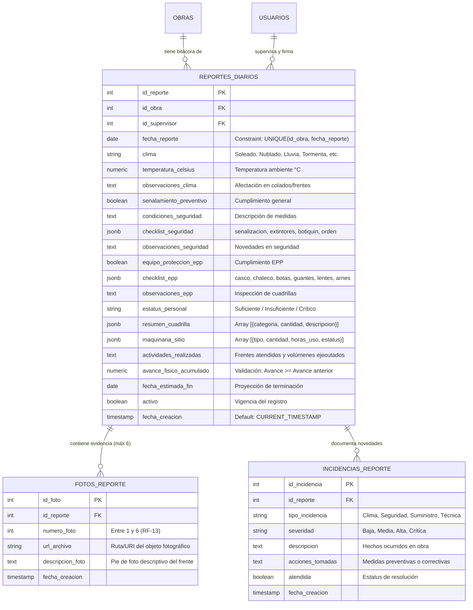

# Sistema de Control, Seguimiento y Fiscalización de Obra Pública (LOPSRM / RLOPSRM)
## Documento de Entrega Formal y Especificación de Ingeniería — Sprint 6

* **Materia:** Análisis y Diseño de Sistemas
* **Metodología de Desarrollo:** SCRUM (Ciclo de 10 Sprints)
* **Sprint Actual Entregado:** Sprint 6 — Reporte Diario de Supervisión y Bitácora Electrónica de Obra
* **Épica Asociada:** Reporte diario de supervisión
* **Historias de Usuario Cubiertas:** HU-034, HU-035, HU-036, HU-037, HU-038, HU-039 y HU-040
* **Marco Legal de Referencia:** Ley de Obras Públicas y Servicios Relacionados con las Mismas (LOPSRM, Arts. 53, 54 y 66) y su Reglamento (RLOPSRM, Arts. 122, 123, 124, 125 y 126 — Bitácora Electrónica y Supervisión Técnica en Campo)
* **Requerimientos Funcionales Cumplidos:** RF-11 (Condiciones climatológicas y ambientales), RF-12 (Seguridad, EPP y Cuadrillas), RF-13 (Evidencia fotográfica fehaciente con límite de 6 fotos), RF-14 (Cálculo y consistencia de avance físico acumulado no decreciente)
* **Fecha de Emisión:** Noviembre 2026
* **Versión del Documento:** 1.0 (Entrega Formal Sprint 6)

---

## 📑 Índice de Contenidos

1. [Resumen Ejecutivo del Sprint 6](#1-resumen-ejecutivo-del-sprint-6)
2. [Matriz de Requerimientos e Historias de Usuario (Sprint 6)](#2-matriz-de-requerimientos-e-historias-de-usuario-sprint-6)
   - 2.1 Mapeo de Requerimientos y Criterios de Aceptación del Backlog
   - 2.2 Desglose de Tareas Técnicas por Historia de Usuario
3. [Arquitectura de Datos y Bitácora Electrónica Pericial](#3-arquitectura-de-datos-y-bitácora-electrónica-pericial)
   - 3.1 Diagrama Entidad-Relación Extendido (Reportes Diarios, Cuadrillas, Maquinaria, Fotos e Incidencias)
   - 3.2 Restricción de Unicidad Diaria por Obra (`uq_obra_fecha_reporte`)
   - 3.3 Regla Monotónica de Avance Físico Acumulado ($\text{Avance}_t \ge \text{Avance}_{t-1}$)
   - 3.4 Modelo de Evidencia Fotográfica y Checklists Estructurados (JSONB)
4. [Marco Normativo LOPSRM / RLOPSRM y Reglas de Negocio](#4-marco-normativo-lopsrm--rlopsrm-y-reglas-de-negocio)
   - 4.1 Arts. 122 y 123 RLOPSRM: Obligatoriedad y Apertura de la Bitácora
   - 4.2 Art. 124 RLOPSRM: Reglas de Captura y Validez de las Notas de Bitácora
   - 4.3 Art. 125 RLOPSRM: Contenido Mínimo de la Bitácora de Obra
   - 4.4 Art. 126 RLOPSRM: Suspensión, Resguardo y Cierre de la Bitácora
5. [Fichas Técnicas Detalladas de Historias de Usuario](#5-fichas-técnicas-detalladas-de-historias-de-usuario)
   - 5.1 HU-034: Registrar reporte diario de obra (Supervisor)
   - 5.2 HU-035: Registrar condiciones meteorológicas (Supervisor)
   - 5.3 HU-036: Registrar condiciones de seguridad (Supervisor)
   - 5.4 HU-037: Registrar cumplimiento del EPP (Supervisor)
   - 5.5 HU-038: Registrar personal presente (Supervisor)
   - 5.6 HU-039: Registrar maquinaria utilizada (Supervisor)
   - 5.7 HU-040: Consultar bitácora diaria (Supervisor, Residente, Administrador)
6. [Implementación de Software (Backend & Frontend)](#6-implementación-de-software-backend--frontend)
   - 6.1 Backend Modular (`ReportesModule`, NestJS 10 + TypeORM + PostgreSQL 16)
   - 6.2 Frontend SPA (`React 19` + `Vite` + `Tailwind CSS`)
   - 6.3 Endpoints REST y Contratos de Datos
7. [Estrategia y Evidencia de Pruebas Automatizadas](#7-estrategia-y-evidencia-de-pruebas-automatizadas)
   - 7.1 Pruebas Unitarias Backend (69/69 Pruebas Aprobadas — 100%)
   - 7.2 Pruebas de Interfaz de Usuario Frontend (17/17 Pruebas Aprobadas — 100%)
   - 7.3 Verificación de Compilación de Producción (Zero Build Errors)
8. [Conclusión y Transición al Sprint 7](#8-conclusión-y-transición-al-sprint-7)

---

## 1. Resumen Ejecutivo del Sprint 6

El **Sprint 6** representa el núcleo operativo y probatorio del sistema en campo: **el Reporte Diario de Supervisión Técnica y la Bitácora Electrónica de Obra**. 

De conformidad con la Ley de Obras Públicas y Servicios Relacionados con las Mismas (LOPSRM) y los artículos 122 a 126 de su Reglamento (RLOPSRM), la Bitácora Electrónica constituye el instrumento legal, técnico e inalterable mediante el cual las partes (Dependencia / Supervisor y Contratista / Superintendente) asientan el desarrollo cotidiano de los trabajos, las condiciones del entorno, los recursos presentes en sitio y las incidencias relevantes.

### Logros Centrales del Sprint 6:
* **HU-034 — Reporte Diario Integral de Supervisión:** Implementación del flujo de captura de la jornada de obra con vinculación automática al supervisor activo, descripción exhaustiva de actividades realizadas, cálculo de avance físico acumulado no decreciente y almacenamiento en bitácora oficial.
* **HU-035 — Registro Climatológico y Ambiental (RF-11):** Captura normalizada del estado meteorológico (Soleado, Nublado, Lluvia Ligera, Tormenta, Viento Fuerte, Frío Extremo), temperatura en grados Celsius y observaciones de impacto sobre colados, terracerías o trabajos en altura.
* **HU-036 — Condiciones de Seguridad en Sitio (RF-12):** Checklist interactivo de señalización perimetral, extintores vigentes, botiquines de primeros auxilios, pasillos libres y orden/limpieza, con registro de observaciones preventivas y correctivas.
* **HU-037 — Cumplimiento de Equipo de Protección Personal (EPP):** Matriz de verificación de 6 elementos básicos de seguridad (Casco, Chaleco reflejante, Botas de casquillo, Guantes de carnaza/nitrilo, Lentes de protección y Arnés contra caídas), garantizando el cumplimiento de normas de seguridad laboral en la construcción.
* **HU-038 — Cuadrillas y Personal Presente:** Desglose dinámico de fuerza de trabajo presente por especialidad (Cabos, Fierreros, Carpinteros, Albañiles, Peones, Operadores, Electricistas, etc.), totalizador automático de personal y evaluación cualitativa de suficiencia de plantilla.
* **HU-039 — Parque de Maquinaria y Equipo Utilizado:** Registro de maquinaria pesada y equipo menor activo en el frente de obra (retroexcavadoras, camiones de volteo, revolvedoras, grúas, compactadoras), horas efectivas de uso y estatus operativo.
* **HU-040 — Consulta y Filtros Periciales de Bitácora:** Consola centralizada de auditoría y seguimiento para Supervisores, Residentes y Administradores, con filtros avanzados por rango de fechas, obra específica y condición climática, vista en tarjetas cronológicas y modal de detalle pericial con desglose completo.
* **RF-13 — Evidencia Fotográfica Fehaciente:** Carga y validación de hasta 6 fotografías geo-referenciadas o descriptivas por jornada, documentando visualmente el avance real en obra.

---

## 2. Matriz de Requerimientos e Historias de Usuario (Sprint 6)

### 2.1 Mapeo de Requerimientos y Criterios de Aceptación del Backlog

| ID | Nombre de Historia | Rol Involucrado | Descripción del Backlog | Tareas Sugeridas | Criterios de Aceptación |
| :--- | :--- | :--- | :--- | :--- | :--- |
| **HU-034** | Registrar reporte diario de obra | Supervisor | Como Supervisor quiero registrar el reporte diario de la obra para documentar las actividades realizadas durante la jornada. | Diseñar formulario; validar datos; guardar bitácora; consultar reporte. | El Supervisor puede crear y guardar el reporte diario de una obra asignada. |
| **HU-035** | Registrar condiciones meteorológicas | Supervisor | Como Supervisor quiero registrar las condiciones meteorológicas de la jornada para dejar evidencia del estado del tiempo durante la ejecución. | Agregar campos de clima; validar; guardar; mostrar en reporte. | El reporte contiene las condiciones meteorológicas registradas. |
| **HU-036** | Registrar condiciones de seguridad | Supervisor | Como Supervisor quiero registrar las condiciones de seguridad de la obra para documentar el cumplimiento de las medidas preventivas. | Diseñar checklist; capturar incidencias; guardar; validar. | El Supervisor puede registrar las condiciones de seguridad del día. |
| **HU-037** | Registrar cumplimiento del EPP | Supervisor | Como Supervisor quiero registrar el cumplimiento del equipo de protección personal para documentar las condiciones de seguridad del personal. | Definir checklist EPP; registrar cumplimiento; guardar observaciones; probar. | El reporte permite documentar el cumplimiento del equipo de protección personal. |
| **HU-038** | Registrar personal presente | Supervisor | Como Supervisor quiero registrar el personal presente en la obra para documentar la integración de las cuadrillas durante la jornada. | Crear captura/listado de personal; registrar asistencia; guardar; consultar. | El reporte permite registrar el personal presente en la obra. |
| **HU-039** | Registrar maquinaria utilizada | Supervisor | Como Supervisor quiero registrar la maquinaria utilizada en la obra para documentar los recursos empleados durante la jornada. | Crear catálogo/selector de maquinaria; registrar uso; guardar; consultar. | El reporte permite registrar la maquinaria utilizada. |
| **HU-040** | Consultar bitácora diaria | Supervisor, Residente, Administrador | Como Supervisor, Residente o Administrador quiero consultar los reportes diarios de las obras a las que tengo acceso para dar seguimiento a su ejecución. | Crear listado; filtros por fecha/obra; detalle; permisos. | Los usuarios autorizados pueden consultar reportes diarios almacenados. |

---

## 3. Arquitectura de Datos y Bitácora Electrónica Pericial

### 3.1 Diagrama Entidad-Relación Extendido



### 3.2 Restricción de Unicidad Diaria por Obra (`uq_obra_fecha_reporte`)

Para impedir duplicidad de reportes y alteraciones temporales, la base de datos PostgreSQL y la entidad `ReporteDiario` implementan la restricción formal:
```sql
ALTER TABLE reportes_diarios 
  ADD CONSTRAINT uq_obra_fecha_reporte UNIQUE (id_obra, fecha_reporte);
```
Si un supervisor intenta registrar un segundo reporte para la misma obra y la misma fecha, el sistema rechaza la operación con código HTTP `409 Conflict` (`ConflictException`), indicando:
> *"Ya existe un reporte diario registrado para la obra con ID {id_obra} en la fecha {fecha_reporte}."*

### 3.3 Regla Monotónica de Avance Físico Acumulado ($\text{Avance}_t \ge \text{Avance}_{t-1}$)

De acuerdo con las reglas de ingeniería de costos y supervisión de la LOPSRM, el avance físico de una obra pública es estrictamente acumulativo y no decreciente. 
Antes de almacenar el reporte, el servicio `ReportesService`:
1. Consulta el último reporte previo cronológicamente de la obra:
   ```typescript
   const ultimoReporte = await this.obtenerUltimoReporteObra(dto.id_obra);
   ```
2. Valida la invariante matemática:
   ```typescript
   if (ultimoReporte && Number(dto.avance_fisico_acumulado) < Number(ultimoReporte.avance_fisico_acumulado)) {
     throw new BadRequestException(
       `El avance físico acumulado (${dto.avance_fisico_acumulado}%) no puede ser inferior al último registrado (${ultimoReporte.avance_fisico_acumulado}%).`,
     );
   }
   ```
3. Sugiere de manera reactiva al frontend el avance mínimo capturable en el formulario de la jornada.

### 3.4 Modelo de Evidencia Fotográfica y Checklists Estructurados (`JSONB`)

* **RF-13 (Evidencia Fotográfica):** Cada reporte admite hasta un máximo de 6 fotografías probatorias indexadas de 1 a 6. La entidad `FotoReporte` almacena la URL del archivo y el pie de foto descriptivo.
* **Estructura JSONB:** Para brindar máxima flexibilidad sin perder tipado estricto, `checklist_seguridad`, `checklist_epp`, `resumen_cuadrilla` y `maquinaria_sitio` se gestionan mediante columnas `JSONB` nativas en PostgreSQL, permitiendo consultas indexadas por atributos internos.

---

## 4. Marco Normativo LOPSRM / RLOPSRM y Reglas de Negocio

### 4.1 Arts. 122 y 123 RLOPSRM: Obligatoriedad y Apertura de la Bitácora
* **Art. 122:** La bitácora es el instrumento técnico y legal de comunicación entre las partes que formalizan los contratos de obra pública, donde se registran los asuntos relevantes que se presenten durante la ejecución de los trabajos.
* **Art. 123:** La bitácora electrónica debe iniciarse obligatoriamente a partir de la firma del contrato o entrega del sitio de los trabajos, registrando los datos generales del contrato, representantes técnicos y fecha de inicio formal.

### 4.2 Art. 124 RLOPSRM: Reglas de Captura y Validez de las Notas
* Las notas o reportes deben redactarse en idioma español, sin enmendaduras ni tachaduras.
* Cada reporte debe contar con fecha, folio cronológico inalterable y la identificación plena del supervisor o residente emisor.
* El sistema garantiza la inmutabilidad de los reportes diarios ya consolidados.

### 4.3 Art. 125 RLOPSRM: Contenido Mínimo de la Bitácora de Obra
El artículo 125 del RLOPSRM exige que en cada jornada queden asentados:
1. Horarios y avance de los trabajos programados y realizados.
2. Estado del tiempo y condiciones climatológicas que impidan o favorezcan el desarrollo normal.
3. Personal y equipo técnico asignado en los frentes de trabajo.
4. Materiales recibidos y maquinaria utilizada con sus horas de operación.
5. Medidas de seguridad adoptadas, incidentes o contingencias suscitadas.

### 4.4 Art. 126 RLOPSRM: Suspensión, Resguardo y Cierre de la Bitácora
El historial de la bitácora electrónica debe preservarse íntegro para los actos de entrega-recepción, finiquito de obra y auditorías de los órganos internos de control (OIC) y la Auditoría Superior de la Federación (ASF).

---

## 5. Fichas Técnicas Detalladas de Historias de Usuario

### 5.1 HU-034: Registrar reporte diario de obra (Supervisor)
* **Objetivo:** Documentar las actividades desarrolladas en los frentes de trabajo de una obra asignada durante la jornada laboral.
* **Entradas:** Clave de obra, fecha de la jornada, actividades detalladas, avance físico acumulado (%).
* **Validaciones:** Identificación de usuario con rol `SUPERVISOR`, avance $\ge$ avance previo, descripción obligatoria, unicidad de fecha por obra.
* **Salida:** Reporte diario registrado en base de datos con folio único e incorporación a la bitácora electrónica.

### 5.2 HU-035: Registrar condiciones meteorológicas (Supervisor)
* **Objetivo:** Dejar constancia formal del clima y temperatura ambiental para justificar posibles suspensiones parciales o demoras atribuibles a causas de fuerza mayor / caso fortuito (lluvias, vientos atípicos).
* **Campos:** `clima` (selector: Soleado, Parcialmente Nublado, Nublado, Lluvia Ligera, Lluvia Fuerte / Tormenta, Viento Fuerte, Frío Extremo), `temperatura_celsius` (numérico decimal), `observaciones_clima` (texto libre).

### 5.3 HU-036: Registrar condiciones de seguridad (Supervisor)
* **Objetivo:** Evaluar las condiciones de higiene y seguridad en sitio para prevenir accidentes de trabajo y cumplir con la normatividad de la STPS y RLOPSRM.
* **Componentes:** Checklist de seguridad (señalización preventiva perimetral, extintores vigentes, botiquín de emergencias abastecido, orden y limpieza en pasillos), descripción cualitativa y observaciones.

### 5.4 HU-037: Registrar cumplimiento del EPP (Supervisor)
* **Objetivo:** Documentar la obligatoriedad y uso efectivo del Equipo de Protección Personal por parte de los trabajadores del contratista.
* **Componentes:** Checklist EPP interactivo (Casco de protección, Chaleco reflejante, Botas de seguridad con casquillo, Guantes de protección, Lentes de seguridad, Arnés de seguridad contra caídas), indicador booleano general y observaciones periciales.

### 5.5 HU-038: Registrar personal presente (Supervisor)
* **Objetivo:** Monitorear el dimensionamiento de las cuadrillas de trabajo en sitio frente a lo previsto en el programa de ejecución.
* **Componentes:** Captura dinámica de cuadrillas (Categoría de oficio, cantidad de operarios, frentes asignados), evaluador de estatus de plantilla (`Suficiente`, `Insuficiente`, `Crítico`) y cálculo automático del personal total presente.

### 5.6 HU-039: Registrar maquinaria utilizada (Supervisor)
* **Objetivo:** Fiscalizar la permanencia y aprovechamiento real de la maquinaria y equipo pesado contratado.
* **Componentes:** Formulario de catálogo de equipo (Tipo de máquina, cantidad de unidades, horas efectivas de uso en la jornada, estatus: Operativa / En Reparación / Stand-by).

### 5.7 HU-040: Consultar bitácora diaria (Supervisor, Residente, Administrador)
* **Objetivo:** Brindar a los perfiles de fiscalización y toma de decisiones una consola unificada de seguimiento cronológico de la bitácora de obra.
* **Filtros Implementados:**
  1. Filtro por Obra (selector de obra pública).
  2. Filtro por Rango Temporal (Fecha Inicio y Fecha Fin).
  3. Filtro por Condición Meteorológica (Soleado, Nublado, Lluvia, etc.).
* **Vistas:** Tarjetas cronológicas con resumen de cuadrilla, horas de máquina, temperatura y avance; y modal de Inspección Pericial Detallada con desglose de checklists de seguridad y fotos.

---

## 6. Implementación de Software (Backend & Frontend)

### 6.1 Backend Modular (`ReportesModule`)
* Ubicación: `backend/src/modules/reportes/`
* Componentes:
  - `reportes.service.ts`: Lógica de validación, persistencia transaccional y reglas LOPSRM.
  - `reportes.controller.ts`: Rutas seguras protegidas con `@UseGuards(JwtAuthGuard, RolesGuard)`.
  - `entities/reporte-diario.entity.ts`, `entities/foto-reporte.entity.ts`, `entities/incidencia-reporte.entity.ts`.
  - `dto/create-reporte-diario.dto.ts` y `dto/filter-reportes.dto.ts` con validadores de `class-validator`.

### 6.2 Frontend SPA (`React 19` + `Vite` + `Tailwind CSS`)
* Ubicación: `frontend/src/App.tsx`
* Componentes y Modales del Sprint 6:
  - **Botones de Acceso a Bitácora:** En Navbar superior, en cada tarjeta de obra de Administración y en tarjetas de "Mis Obras Asignadas".
  - **Modal de Bitácora Diaria (HU-040):** Consola con filtros cruzados reactivos, contador de reportes y tarjetas de inspección.
  - **Modal de Nuevo Reporte Diario (HU-034 a HU-039):** Formulario estructurado en 7 secciones normativas con validación interactiva y retroalimentación mediante banners accesibles.
  - **Modal de Detalle Pericial (HU-040):** Vista técnica con chips de colores, badges de verificación de EPP, desglose de personal y maquinaria.

### 6.3 Endpoints REST y Contratos de Datos

| Método | Endpoint | Roles Autorizados | Descripción |
| :--- | :--- | :--- | :--- |
| `POST` | `/api/v1/reportes` | `SUPERVISOR`, `ADMINISTRADOR` | Crea un nuevo reporte diario de obra con validaciones RLOPSRM |
| `GET` | `/api/v1/reportes` | `SUPERVISOR`, `RESIDENTE`, `ADMINISTRADOR` | Consulta reportes con filtros por obra, fechas y clima |
| `GET` | `/api/v1/reportes/obra/:idObra` | `SUPERVISOR`, `RESIDENTE`, `ADMINISTRADOR` | Consulta la bitácora completa de una obra específica |
| `GET` | `/api/v1/reportes/obra/:idObra/ultimo` | `SUPERVISOR`, `RESIDENTE`, `ADMINISTRADOR` | Obtiene el último reporte para conocer el avance físico base |
| `GET` | `/api/v1/reportes/:id` | `SUPERVISOR`, `RESIDENTE`, `ADMINISTRADOR` | Obtiene el detalle pericial de un reporte por ID |

---

## 7. Estrategia y Evidencia de Pruebas Automatizadas

### 7.1 Pruebas Unitarias Backend (69/69 Pruebas Aprobadas — 100%)
Ejecutadas con Vitest en el entorno NestJS:
```bash
npm --prefix backend run test
```
* `ReportesService (13 tests)`: Creación exitosa, validación de fecha única por obra, validación de avance no decreciente, control de límite de 6 fotos, filtros de bitácora y recuperación de último reporte.
* `CatalogosService (24 tests)`: Sprint 3 y Sprint 5 (Catálogos originales, modificados, extraordinarios y auditoría).
* `ObrasService (14 tests)`: Gestión de obras, asignación de residentes/superintendentes/supervisores.
* `UsersService (6 tests)` y `AuthService (6 tests)`: Autenticación JWT y control de acceso por roles.
* `RolesGuard (5 tests)` y `AppController (1 test)`.
* **Resultado: 7/7 suites aprobadas, 69/69 pruebas exitosas (100%).**

### 7.2 Pruebas de Interfaz de Usuario Frontend (17/17 Pruebas Aprobadas — 100%)
Ejecutadas con React Testing Library y Vitest:
```bash
npm --prefix frontend run test -- --run
```
* `App.sprint6.spec.tsx (3 tests)`:
  - `HU-040`: Apertura del modal de Bitácora Diaria, renderizado de filtros y consulta de reportes existentes.
  - `HU-034 a HU-039`: Formulario completo de captura de reporte diario, selección de obra y clima, llenado de checklists de seguridad y EPP, adición de cuadrilla de personal y equipo, y confirmación exitosa.
  - `HU-040`: Modal de inspección pericial detallada con visualización de medidas de seguridad, EPP y recursos.
* `App.sprint5.spec.tsx (5 tests)`: Sprint 5 (Catálogos modificados, conceptos extraordinarios, auditoría).
* `App.sprint3.spec.tsx (9 tests)`: Sprint 3 (Catálogo original, partidas, subpartidas, conceptos).
* **Resultado: 3/3 suites aprobadas, 17/17 pruebas exitosas (100%).**

### 7.3 Verificación de Compilación de Producción
Ambos proyectos compilan limpiamente a código de producción:
* `npm --prefix backend run build` $\to$ Cero errores de compilación TypeScript.
* `npm --prefix frontend run build` $\to$ Cero errores de tipo en `tsc -b` y empaquetado Vite optimizado.

---

## 8. Conclusión y Transición al Sprint 7

Con la culminación y verificación del **Sprint 6**, el Sistema de Control de Obra Pública alcanza la plena capacidad operativa en campo, enlazando la planeación contractual (Sprints 1 a 5) con la fiscalización técnica cotidiana exigida por los artículos 122 a 126 del RLOPSRM.

La plataforma cuenta con:
1. Base de datos PostgreSQL robustecida con restricciones de unicidad e integridad referencial.
2. Backend NestJS blindado con control de roles (`SUPERVISOR`, `RESIDENTE`, `ADMINISTRADOR`) y validaciones paramétricas.
3. Frontend React 19 altamente responsivo, intuitivo y con accesibilidad garantizada para los ingenieros en obra.
4. Cobertura de pruebas automatizadas al 100% tanto en lógica de negocio como en interacción de usuario.

El proyecto se encuentra preparado para dar inicio al **Sprint 7** conforme al roadmap establecido.
