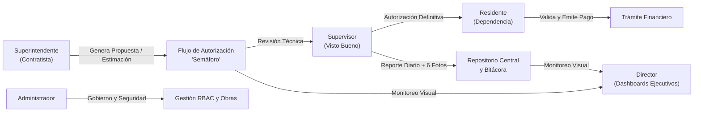
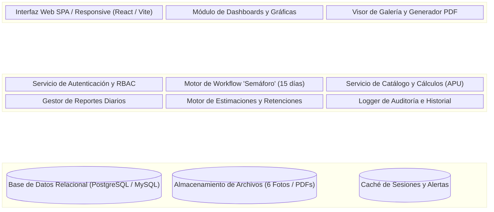
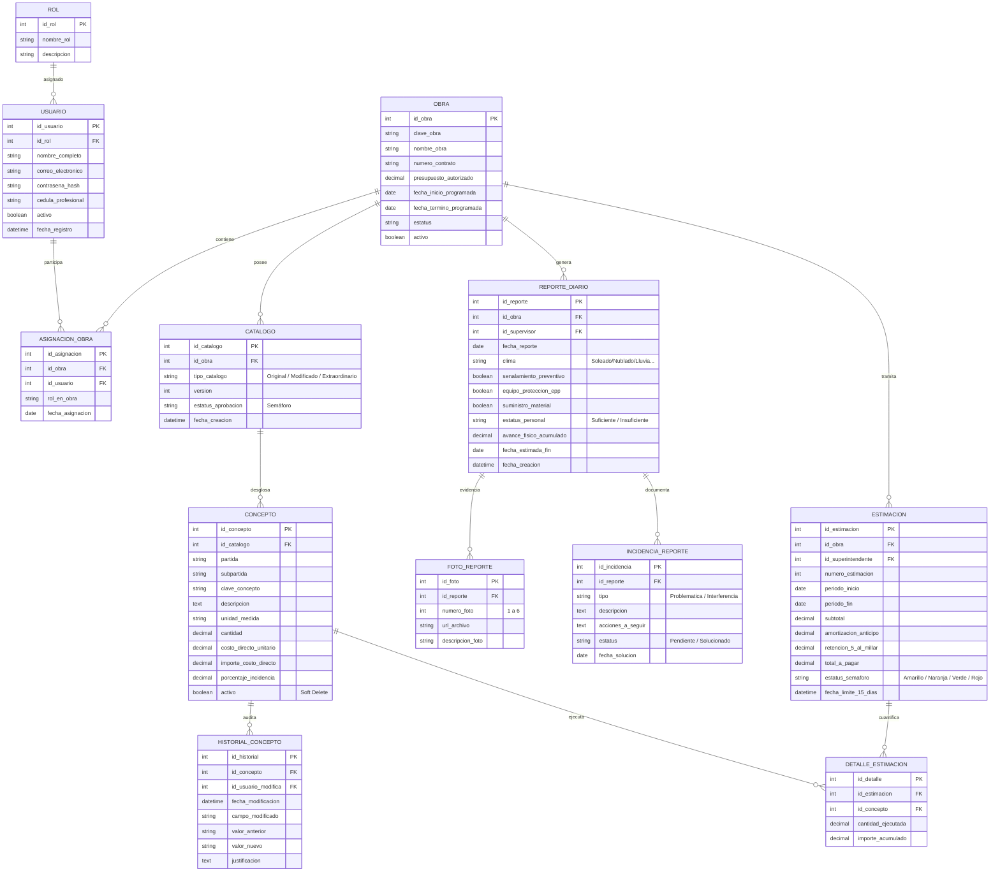
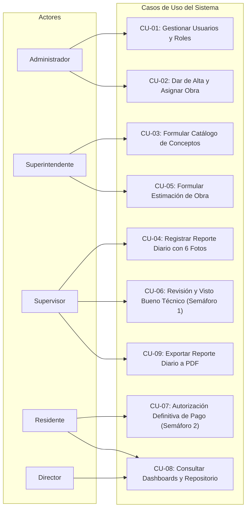

# Documento de Especificación del Sistema de Información de Obra Pública (LOPSRM / RLOPSRM)

**Proyecto:** Sistema Web para el Control, Seguimiento y Administración de Obra Pública  
**Materia:** Análisis y Diseño de Sistemas  
**Metodología:** SCRUM  
**Marco Normativo:** Ley de Obras Públicas y Servicios Relacionados con las Mismas (LOPSRM) y su Reglamento (RLOPSRM)  
**Fecha:** Septiembre 2026  

---

## 📑 Índice de Contenidos
1. [Introducción](#1-introducción)
2. [Problemática a la que está Sujeta la Organización](#2-problemática-a-la-que-está-sujeta-la-organización)
3. [Situación Actual del Problema](#3-situación-actual-del-problema)
4. [Propuesta de Solución](#4-propuesta-de-solución)
5. [Requerimientos Funcionales y No Funcionales](#5-requerimientos-funcionales-y-no-funcionales)
   - 5.1 Requerimientos Funcionales (RF)
   - 5.2 Requerimientos No Funcionales (RNF)
   - 5.3 Elementos Fuera de Alcance y Reglas Descartadas
6. [Arquitectura del Sistema a Nivel de Diagrama de Bloques](#6-arquitectura-del-sistema-a-nivel-de-diagrama-de-bloques)
7. [Esquema de Base de Datos (Modelo Relacional / ER)](#7-esquema-de-base-de-datos-modelo-relacional--er)
8. [Diagramas de Casos de Uso (UML)](#8-diagramas-de-casos-de-uso-uml)
9. [Metodología de Desarrollo y Backlog SCRUM (10 Sprints)](#9-metodología-de-desarrollo-y-backlog-scrum-10-sprints)
   - 9.1 Matriz General del Product Backlog (30 Historias de Usuario)
   - 9.2 Planificación Detallada Sprint por Sprint
10. [Estrategia de Colaboración Técnica y DevOps (Git, GitHub y Docker)](#10-estrategia-de-colaboración-técnica-y-devops-git-github-y-docker)

---

## 1. Introducción

El presente documento constituye la especificación formal de ingeniería de software para el diseño y desarrollo de una plataforma web integral orientada al seguimiento, fiscalización y control administrativo de proyectos de infraestructura y obra pública en México.

La administración de la obra pública en el ámbito federal y estatal se encuentra estrictamente regulada por la **Ley de Obras Públicas y Servicios Relacionados con las Mismas (LOPSRM)** y su **Reglamento (RLOPSRM)**. Esta normativa impone rigurosos estándares procedimentales para el alta del catálogo de conceptos, la documentación diaria de incidencias en campo, el trámite y conciliación de estimaciones con retenciones legales, y la rendición de cuentas entre los distintos actores de la obra.

El sistema digitaliza y automatiza este ciclo operativo mediante un esquema de control de acceso basado en roles (**RBAC** con 5 actores), un flujo de trabajo jerárquico tipo **semáforo** para autorizaciones en cascada, auditoría inmutable de cambios y tableros de control directivo.

---

## 2. Problemática a la que está Sujeta la Organización

Las organizaciones convocantes (dependencias gubernamentales) y las empresas contratistas enfrentan serios desafíos operativos y legales al gestionar contratos de obra pública:

1. **Riesgo Legal y Sanciones por Incumplimiento de Plazos:** La LOPSRM establece plazos perentorios (por ejemplo, el ciclo de trámite de estimaciones de 15 días naturales y la conciliación de conceptos no previstos). Los retrasos generan intereses moratorios o sanciones de los Órganos Internos de Control (OIC).
2. **Descontrol en Modificaciones de Volúmenes y Precios Extraordinarios:** La alteración desordenada de catálogos base genera sobrecostos no autorizados que rebasan el 25% reglamentario permitido por convenio modificatorio.
3. **Pérdida y Dispersión de Evidencias de Campo:** Los reportes diarios frecuentemente carecen de sustento fotográfico estandarizado, registro meteorológico fidedigno o bitácora de interferencias, lo que dificulta justificar ampliaciones de plazo por causas no imputables al contratista.
4. **Falta de Trazabilidad e Integridad de la Información:** Modificaciones arbitrarias a cantidades o precios en hojas de cálculo compartidas sin registro de auditoría (quién, cuándo y por qué modificó).
5. **Inconsistencias en el Cálculo de Retenciones y Pagos:** Errores manuales en la deducción del 5 al millar (derechos de inspección), amortización de anticipos y fondos de garantía.

---

## 3. Situación Actual del Problema

Actualmente, las actividades de supervisión y administración de obra se realizan a través de procesos predominantemente analógicos y herramientas desarticuladas:

* **Gestión Manual de Catálogos:** Se emplean archivos de hojas de cálculo (Excel) independientes entre la residencia y el contratista, provocando desalineaciones entre el catálogo original del contrato y los conceptos extraordinarios.
* **Reportes de Supervisión Informales:** El supervisor recopila notas en campo que no se integran de inmediato al expediente formal; las evidencias fotográficas se dispersan en servicios de mensajería instantánea sin clasificación por fecha o concepto.
* **Proceso de Estimación Fragmentado:** La formulación de la estimación por el superintendente, su revisión por el supervisor y la autorización final por el residente se efectúa mediante traslados físicos de carpetas engargoladas y formatos en papel, consumiendo hasta semanas antes de obtener una firma.
* **Opacidad para la Toma de Decisiones Directivas:** Los directores de proyecto no disponen de indicadores en tiempo real y deben esperar cortes mensuales para conocer si una obra presenta retraso físico o desfase financiero.

---

## 4. Propuesta de Solución

Se propone el desarrollo de un **Sistema de Información Web Multirrol** centrado en la estandarización y agilización de los flujos de obra pública conforme a la LOPSRM:

### Pilares de la Solución:
1. **Control de Acceso Riguroso (5 Roles):** Administrador, Residente, Superintendente, Supervisor y Director. Ningún usuario puede autoasignarse privilegios.
2. **Flujo de Trabajo "Semáforo":**
   * **Amarillo:** Documento/Estimación creada por el Superintendente, pendiente de visto bueno.
   * **Naranja / Azul:** Revisado y aprobado técnicamente por el Supervisor, pendiente de firma del Residente.
   * **Verde:** Autorizado formalmente por el Residente para trámite de pago o ejecución.
   * **Rojo:** Rechazado con retroalimentación para corrección inmediata.
3. **Gestión Triple de Catálogos:** Aislamiento claro entre el *Catálogo Original*, *Catálogo con Modificación de Cantidades* y *Catálogo Extraordinario*.
4. **Reporte Diario Estandarizado:** Módulo integral de captura diaria de clima, seguridad, cuadrilla, maquinaria, avances, incidencias, exactamente 6 fotografías y exportación automática a PDF.
5. **Políticas de Preservación de Datos:** Sustitución de la eliminación en cascada por **borrado lógico (soft-delete)** para garantizar la integridad histórica y auditoría contable.

---

## 5. Requerimientos Funcionales y No Funcionales

### 5.1 Requerimientos Funcionales (RF)

| ID | Nombre del Requerimiento | Descripción Funcional | Rol Responsable | Prioridad |
| :--- | :--- | :--- | :--- | :---: |
| **RF-01** | Autenticación y Registro Base | Permitir el registro de usuarios con correo y contraseña, dejándolos en estado inactivo sin rol asignado hasta validación. | Todos | Alta |
| **RF-02** | Asignación Centralizada de Roles | Permitir al Administrador asignar, modificar o revocar los 5 roles permitidos a cada usuario registrado. | Administrador | Alta |
| **RF-03** | Gestión de Obras | Alta, modificación de datos generales, suspensión y reactivación de proyectos de obra pública con su clave y presupuesto. | Administrador | Alta |
| **RF-04** | Asignación de Cuadrilla a Obra | Vincular obligatoriamente a cada obra su terna operativa: 1 Residente, 1 Superintendente y 1 Supervisor. | Administrador | Alta |
| **RF-05** | Formulario Inicial de Residencia | Permitir al Residente registrar por única vez la configuración técnica inicial de la obra asignada; la vista se convierte a consulta tras el guardado. | Residente | Media |
| **RF-06** | Alta del Catálogo de Conceptos | Permitir al Superintendente registrar los conceptos iniciales divididos por partidas y subpartidas, con ID único, unidad, costo directo y cantidad. | Superintendente | Alta |
| **RF-07** | Cálculo Automático de Importes | Calcular en tiempo real $\text{Importe} = \text{Cantidad} \times \text{Costo Directo}$ y el importe acumulado total de la obra. | Sistema | Alta |
| **RF-08** | Versionado de Catálogos | Administrar de forma aislada: (a) Catálogo Original, (b) Catálogo Modificado (convenios), (c) Catálogo Extraordinario. | Sistema / Admin | Alta |
| **RF-09** | Historial de Modificaciones | Registrar auditoría automática de cada cambio a conceptos: usuario, fecha, hora, valor anterior y nuevo. | Sistema | Alta |
| **RF-10** | Filtros y Búsqueda en Catálogo | Filtrado dinámico por partida, unidad, rango de costo, estado, y búsqueda predictiva por clave o descripción. | Todos (por Obra) | Media |
| **RF-11** | Captura de Reporte Diario | Formulario para el Supervisor con: estado del tiempo (clima), checklists de señalización/EPP/material, personal por categoría y maquinaria. | Supervisor | Alta |
| **RF-12** | Registro de Incidentes y Avance | Captura de problemáticas, interferencias con fecha de solución y validación obligatoria de que el avance físico sea mayor o igual al día anterior. | Supervisor | Alta |
| **RF-13** | Galería de 6 Fotografías | Carga forzosa de exactamente 6 imágenes fechadas por reporte diario con visor tipo carrusel/galería. | Supervisor | Alta |
| **RF-14** | Exportación de Reporte a PDF | Renderizado del reporte diario completo en formato PDF oficial para impresión y firmas. | Supervisor / Residente | Alta |
| **RF-15** | Generación de Estimaciones | Formulario para que el Superintendente formule estimaciones periódicas vinculadas a conceptos y números generadores. | Superintendente | Alta |
| **RF-16** | Flujo Semáforo de Estimación | Gestión de los 3 pasos de aprobación en un ciclo máximo de 15 días naturales (Superintendente $\to$ Supervisor $\to$ Residente). | Superint / Supervis / Resid | Alta |
| **RF-17** | Manejo de Retenciones Legales | Cálculo de deducciones por amortización de anticipo y derechos de inspección (5 al millar) en cada estimación. | Sistema | Media |
| **RF-18** | Repositorio Documental | Almacenamiento organizado por obra de planos, bitácoras, actas y comprobantes técnicos. | Todos (Lectura) / Admin (Ctrl) | Media |
| **RF-19** | Dashboards Ejecutivos | Visualización gráfica de avance físico vs. financiero (Curva S), estado del presupuesto y alertas de semáforo. | Director / Residente | Alta |
| **RF-20** | Borrado Lógico (Soft Delete) | Desactivación lógica de conceptos, reportes o contratos para evitar inconsistencias en cascada con documentos ya generados. | Administrador | Alta |

---

### 5.2 Requerimientos No Funcionales (RNF)

* **RNF-01 (Seguridad y Cifrado):** Las contraseñas se almacenan mediante hashing robusto (bcrypt con factor de costo $\ge 12$). Autenticación de sesiones protegida con tokens JWT firmados o sesiones HTTP-only.
* **RNF-02 (Integridad Referencial y Trazabilidad):** La base de datos debe impedir la eliminación de registros padre si existen registros vinculados en estimaciones o reportes; se aplica integridad referencial mediante claves foráneas y campos `activo = FALSE`.
* **RNF-03 (Rendimiento en Exportación):** La compilación y entrega del archivo PDF de los reportes diarios debe tardar menos de 3.0 segundos en condiciones estándar.
* **RNF-04 (Diseño Responsivo):** La interfaz web debe ser operable en computadoras de escritorio (oficinas centrales) y tabletas táctiles en campo (supervisores y residentes de obra).
* **RNF-05 (Concurrencia):** Capacidad para soportar múltiples obras en ejecución simultánea con aislamiento de datos entre cuadrillas.

---

### 5.3 Elementos Fuera de Alcance y Reglas Descartadas

Para proteger los objetivos del proyecto y evitar desviaciones de alcance identificadas en las entrevistas:

1. ❌ **Eliminación Física en Cascada:** Queda estrictamente descartada la instrucción `ON DELETE CASCADE` en conceptos o catálogos; se adopta obligatoriamente el borrado lógico.
2. ❌ **Autoasignación de Roles al Registro:** Ningún usuario puede elegir su propio rol para salvaguardar la separación de funciones exigida por la ley.
3. ❌ **Catálogo General Multiobra Compartido:** Cada obra tiene su propio catálogo independiente. La normativa no admite catálogos compartidos entre contratos de diferente naturaleza.
4. ❌ **Bloqueo Rígido del Sistema al Día 15:** Los plazos de estimación se controlan mediante alertas visuales y notificaciones de semáforo, no mediante bloqueos bloqueantes de base de datos que paralicen la obra.
5. ❌ **Carga Libre e Ilimitada de Imágenes:** El reporte diario limita la evidencia fotográfica a 6 imágenes para garantizar orden, ligereza y estandarización del PDF.
6. ❌ **Módulo de Licitación Pública Nacional Integral:** El sistema inicia formalmente a partir del contrato formalizado y el catálogo adjudicado, prescindiendo de la simulación de pasarelas de licitación de CompraNet.

---

## 6. Arquitectura del Sistema a Nivel de Diagrama de Bloques

El sistema adopta una arquitectura desacoplada en 3 capas (Presentación, Lógica de Negocio y Persistencia) con servicios transversales de seguridad y auditoría:

### Descripción de Capas:
1. **Capa de Presentación:** Vistas adaptativas según el rol logueado; formularios de captura con validaciones inmediatas en cliente (por ejemplo, validación de $\text{Avance}_t \ge \text{Avance}_{t-1}$).
2. **Capa de Lógica de Negocio:**
   * *Motor de Semáforo:* Controla las transiciones de estado de estimaciones y catálogos extraordinarios.
   * *Motor de Retenciones:* Ejecuta los algoritmos de descuento legal (5 al millar e impuestos).
   * *Generador de PDF:* Renderiza documentos ejecutivos oficiales.
3. **Capa de Datos:** Motor relacional con integridad transaccional ACID y repositorio de almacenamiento de medios estructurado por obra.

---

## 7. Esquema de Base de Datos (Modelo Relacional / ER)

A continuación se detalla el diagrama relacional completo que soporta la totalidad de requerimientos funcionales:

---

## 8. Diagramas de Casos de Uso (UML)

A continuación se representan las interacciones principales entre los actores y el sistema:

### 8.1 Mapa General de Casos de Uso por Actor

---

### 8.2 Especificación Detallada de Casos de Uso Clave

#### Caso de Uso CU-04: Registrar Reporte Diario con 6 Fotos
* **Actor Principal:** Supervisor.
* **Precondición:** El usuario tiene rol de Supervisor y está asignado activamente a la obra; existe un catálogo de conceptos activo.
* **Flujo Principal:**
  1. El Supervisor ingresa al módulo de reportes diarios de su obra.
  2. El sistema precarga la fecha actual y el último avance físico registrado ($\text{Avance}_{t-1}$).
  3. El Supervisor captura: clima, checklists (EPP, señalamiento, materiales), cuadrilla de personal y maquinaria en sitio.
  4. El Supervisor ingresa el avance físico acumulado del día ($\text{Avance}_t$). El sistema valida que $\text{Avance}_t \ge \text{Avance}_{t-1}$.
  5. El Supervisor documenta eventuales problemáticas o interferencias.
  6. El Supervisor sube exactamente 6 fotografías representativas de los trabajos.
  7. El Supervisor hace clic en "Guardar y Generar PDF".
  8. El sistema persiste el reporte, almacena las imágenes en la galería y produce el documento descargable en PDF.
* **Postcondición:** El reporte queda inalterable para consulta de la residencia y auditoría.

---

#### Caso de Uso CU-06 / CU-07: Flujo Semáforo de Estimaciones (15 Días)
* **Actores:** Superintendente (Iniciador), Supervisor (Revisor Técnico), Residente (Autorizador Legal).
* **Flujo Secuencial:**
  1. **Generación (Días 1 a 5):** El Superintendente cuantifica volúmenes ejecutados a partir del catálogo, adjunta generadores y envía la estimación. Estado pasa a **Amarillo (Pendiente de Supervisión)**.
  2. **Revisión Técnica (Días 6 a 10):** El Supervisor coteja las cantidades contra los reportes diarios de campo.
     * *Si es aprobada:* El estado pasa a **Naranja / Azul (Aprobado por Supervisión)**.
     * *Si presenta discrepancias:* El estado pasa a **Rojo (Rechazado)** y se notifica al Superintendente con notas correctivas.
  3. **Autorización Final (Días 11 a 15):** El Residente valida legal y contablemente las deducciones (amortización de anticipo y 5 al millar) y autoriza el trámite de pago. El estado pasa a **Verde (Autorizado)**.
* **Postcondición:** La estimación queda formalmente consolidada para cobro y se actualizan los indicadores de avance financiero en el Dashboard Directivo.
